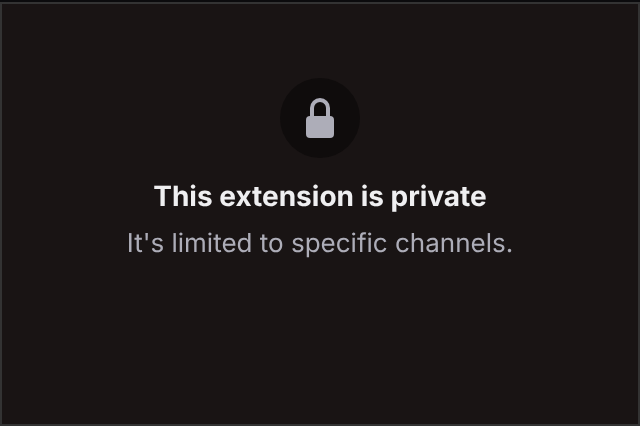
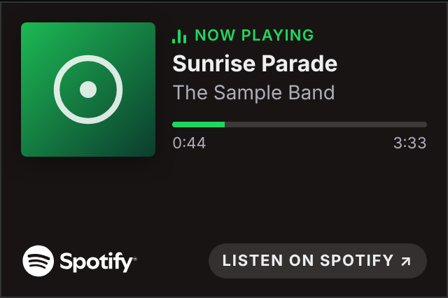
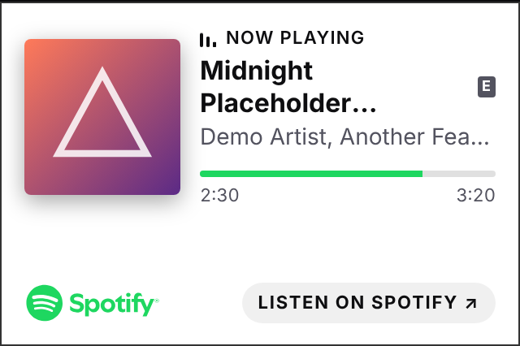
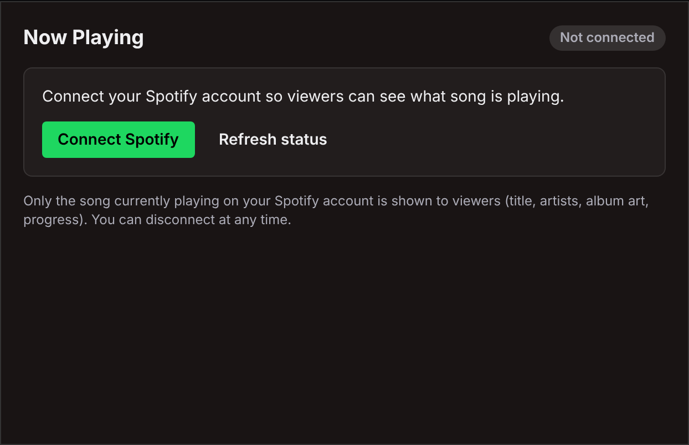
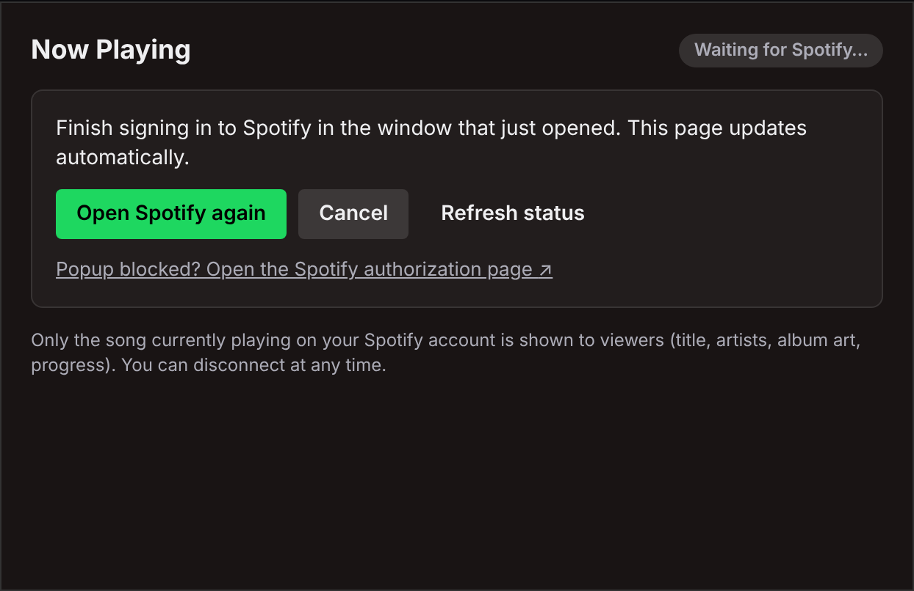
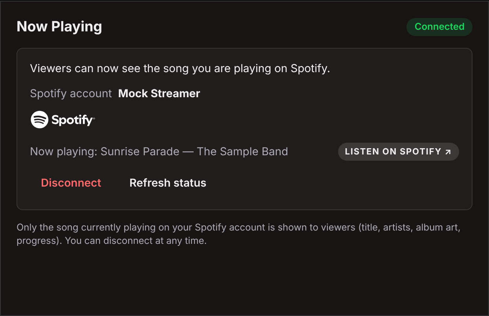
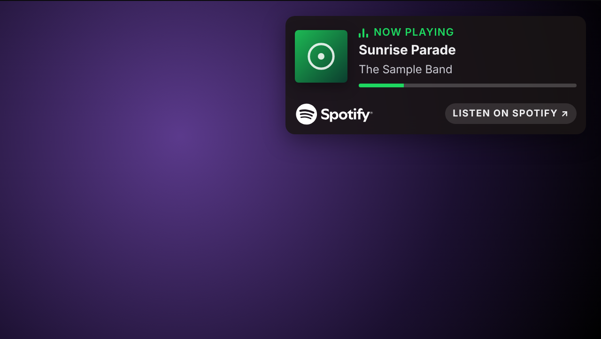
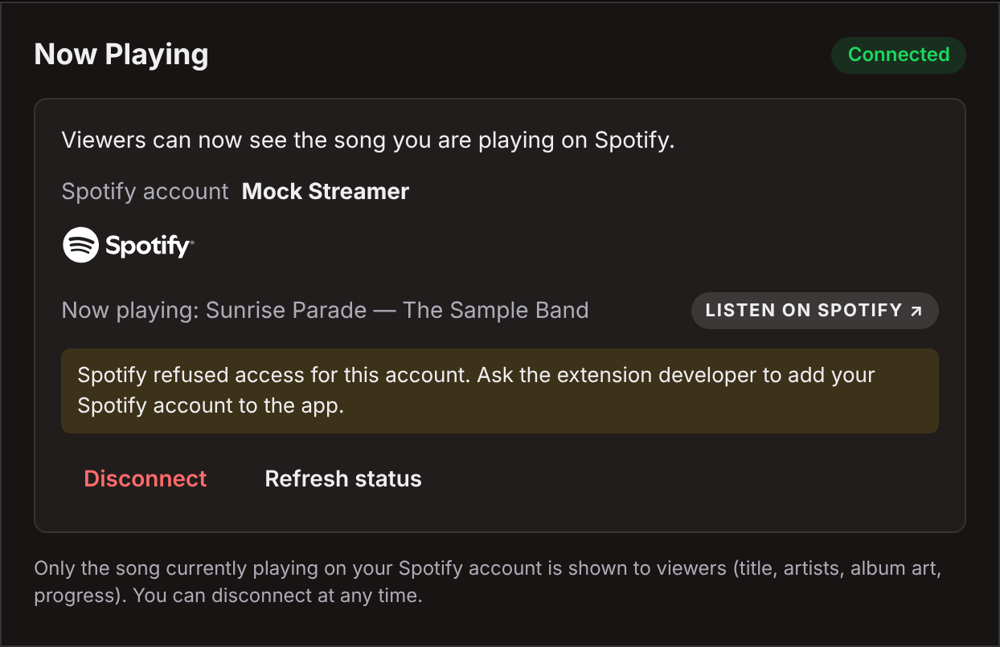

# Crea tu propia extensión de Twitch "Now Playing" para Spotify: paso a paso

Esta guía te lleva de cero a una extensión funcionando en tu propio canal de Twitch. Usa el código de este
repositorio tal cual: solo tienes que crear cuentas, rellenar ajustes y ejecutar unos pocos comandos.

*Read in English: [GUIDE.md](GUIDE.md)*

**Marcadores que se usan en toda la guía.** Sustitúyelos por tus propios valores:

| Marcador | Qué es | Dónde se obtiene |
|---|---|---|
| `<your-app>` | El nombre de tu app en Fly.io. La URL de tu backend será `https://<your-app>.fly.dev` | Lo eliges tú (paso 4) |
| `YOUR_SPOTIFY_CLIENT_ID` | Client ID de tu app de Spotify | Panel de Spotify (paso 2) |
| `YOUR_TWITCH_EXTENSION_CLIENT_ID` | Client ID de tu extensión de Twitch | Consola de desarrolladores de Twitch (paso 3) |
| `YOUR_TWITCH_USER_ID` | ID numérico de usuario de Twitch de la cuenta propietaria de la extensión | Paso 3.8 |

Nunca publiques ni compartas el **client secret de Spotify**, el **secreto de la extensión de Twitch** ni la **clave de
cifrado de tokens**.

Los nombres de botones y campos de las consolas de Twitch, Spotify y Fly.io se dejan en inglés, tal como aparecen en
pantalla.

## Contenido
1. [Requisitos previos](#1-requisitos-previos)
2. [Crear la app de Spotify](#2-crear-la-app-de-spotify)
3. [Crear la extensión de Twitch](#3-crear-la-extensión-de-twitch)
4. [Desplegar el backend en Fly.io](#4-desplegar-el-backend-en-flyio)
5. [Empaquetar el frontend](#5-empaquetar-el-frontend)
6. [Desarrollo y pruebas en local](#6-desarrollo-y-pruebas-en-local)
7. [Instalar en tu canal y conectar Spotify](#7-instalar-en-tu-canal-y-conectar-spotify)
8. [Solución de problemas](#8-solución-de-problemas)
9. [Actualizar y volver a desplegar](#9-actualizar-y-volver-a-desplegar)
10. [Límites conocidos y notas sobre políticas](#10-límites-conocidos-y-notas-sobre-políticas)

---

## 1. Requisitos previos

- **Una cuenta de Twitch con la verificación en dos pasos (2FA)** activada. La consola de desarrolladores la exige.
- **Una cuenta de Spotify Premium.** El propietario de una app de Spotify en Development Mode debe tener Premium; si no,
  la app deja de funcionar. Los streamers que vinculan su cuenta no necesitan Premium.
- **Una cuenta de Fly.io con una tarjeta de crédito** registrada. La prueba gratuita detiene las máquinas a los pocos
  minutos, y eso no sirve para un backend que tiene que consultar Spotify sin parar. Una máquina pequeña más un
  volumen de 1 GB cuesta unos pocos dólares al mes; consulta los
  [precios de Fly.io](https://fly.io/docs/about/pricing/).
- **Node.js 20.6 o posterior** y **git** en tu ordenador.
- **Google Chrome o Chromium**, solo si quieres ejecutar las pruebas end-to-end del frontend.
- **OpenSSL** (viene instalado en macOS y en la mayoría de distribuciones Linux) para generar la clave de cifrado.
- Una copia de este repositorio:
  ```bash
  git clone https://github.com/<tu-usuario>/playing-sp.git
  cd playing-sp
  ```

---

## 2. Crear la app de Spotify

1. Inicia sesión en el [Spotify Developer Dashboard](https://developer.spotify.com/dashboard) con la cuenta
   **Premium** que será la propietaria de la app.
2. Haz clic en **Create app** y rellena:
   - **App name** y **App description**: lo que quieras.
   - **Redirect URIs**: añade exactamente
     ```
     https://<your-app>.fly.dev/auth/spotify/callback
     ```
     Eliges `<your-app>` en el paso 4, así que decide el nombre ya. Debe coincidir carácter por carácter con la variable
     `SPOTIFY_REDIRECT_URI` del backend. Spotify exige HTTPS y no acepta `localhost`. Para pruebas en local también
     puedes añadir una dirección de loopback como `http://127.0.0.1:8787/auth/spotify/callback` (consulta el paso 6.3
     y las [reglas de Spotify sobre redirect URIs](https://developer.spotify.com/documentation/web-api/concepts/redirect_uri)).
   - **Which API/SDKs are you planning to use?**: marca **Web API**.
   - Acepta las condiciones y guarda.
3. Abre **Settings** en la app y copia el **Client ID** (`YOUR_SPOTIFY_CLIENT_ID`) y el **Client secret**. Los
   configurarás en el backend en el paso 4. Guarda el secreto en un lugar privado.
4. Abre **User Management** y añade a cada streamer que vaya a vincular Spotify, con su nombre y el correo de su
   cuenta de Spotify. El propietario de la app ya tiene acceso.
   - **Development Mode admite como máximo 5 usuarios por app.** Quien no esté en la lista puede iniciar sesión igualmente,
     pero Spotify responde a las peticiones del backend con un **403**. La página de configuración muestra entonces
     "Spotify refused access for this account".
   - Para superar los 5 usuarios hace falta el Extended Quota Mode de Spotify, que solo se concede a organizaciones que
     cumplen sus criterios. Consulta [Quota modes](https://developer.spotify.com/documentation/web-api/concepts/quota-modes).

El backend solo pide dos permisos de lectura: `user-read-currently-playing` y `user-read-playback-state`. Nunca controla
la reproducción.

---

## 3. Crear la extensión de Twitch

Las pestañas y los nombres de campo de la consola que aparecen a continuación provienen de la página
[Extensions Life Cycle Management](https://dev.twitch.tv/docs/extensions/life-cycle/) de Twitch.

1. Abre la [consola de desarrolladores de Twitch → Extensions](https://dev.twitch.tv/console/extensions) y haz clic en
   **Create Extension**. Ponle un nombre. Así se crea la primera versión (por ejemplo, `0.0.1`) en **Local Test**.
2. Abre la versión y haz clic en **Manage** para entrar en el Extensions Manager (pestañas: Status, Version Details,
   Capabilities, Monetization, Files, Asset Hosting y Access).
3. Pestaña **Asset Hosting**:
   - **Type of Extension**: marca **Panel**, **Video - Fullscreen** y **Video - Component** (o solo los que quieras).
   - **Panel Viewer Path**: `panel.html`; **Panel Height**: `210`.
   - Ruta de visualización de **Video - Fullscreen**: `video_overlay.html`.
   - Ruta de visualización de **Video - Component**: `video_component.html`.
   - **Config Path**: `config.html`.
   - **Live Config Path**: `live_config.html`.
   - **Testing Base URI**: solo se usa en Local Test (paso 6.3). El valor predeterminado `https://localhost:8080/`
     sirve.
   - Las rutas son relativas a la raíz del zip, sin carpeta delante.
4. Pestaña **Capabilities**:
   - **Allowlist for URL Fetching Domains**: `https://<your-app>.fly.dev` (tu backend).
   - **Allowlist for Image Domains**: `https://i.scdn.co` (portadas de álbumes y pódcasts de Spotify).
   - **Allowlist for Media Domains**: déjalo vacío.
   - **Allowlist Config URLs**: `https://accounts.spotify.com` (la ventana emergente de inicio de sesión de Spotify) y
     `https://open.spotify.com` (el enlace de la página de configuración a la canción actual).
   - **Allowlisted Panel URLs**: `https://open.spotify.com` (el enlace "LISTEN ON SPOTIFY").
   - **Request Identity Link**: No. **Chat Capabilities**: No.
   - **Select how you will configure your Extension**: elige **No configuration**. La opción predeterminada de la
     consola es el *Extensions Configuration Service* alojado por Twitch, que este proyecto no usa, así que cámbiala.
   - *Opcional:* si quieres que Twitch solo permita activar la extensión después de vincular Spotify, elige
     **Custom/My Own Service** e introduce la cadena de configuración obligatoria `spotify-linked-v1`. Después pon la
     misma cadena en la variable `TWITCH_REQUIRED_CONFIGURATION` del backend y el número de versión (por ejemplo,
     `0.0.1`) en `TWITCH_EXTENSION_VERSION` (paso 4.5). Tras una vinculación correcta, el backend fija esa cadena para
     el canal mediante la API de Twitch, y la página de configuración muestra "Finishing setup with Twitch…" hasta que
     termina.
5. Pestaña **Monetization**: **Bits support: No**, **Subscription support: No**. Hay que guardar estos campos antes de
   pasar a Hosted Test.
6. Pestaña **Access** (opcional): añade los ID numéricos de otras cuentas que deban poder probarla. Tu propia cuenta
   siempre puede.
7. **Extension settings → Secret Keys**: copia la **Key** (en base64). Es el secreto de la extensión para la variable
   `TWITCH_EXTENSION_SECRET` del backend. Copia también el **Client ID** de la extensión
   (`YOUR_TWITCH_EXTENSION_CLIENT_ID`), que aparece en las páginas de resumen y de ajustes de la extensión. Consulta
   [Managing Extension Secrets](https://dev.twitch.tv/docs/extensions/building/). Guarda el secreto en un lugar
   privado.
8. **Tu ID numérico de usuario de Twitch** (`YOUR_TWITCH_USER_ID`), para `TWITCH_EXTENSION_OWNER_ID`: es un número, no
   tu nombre de usuario. Puedes consultarlo con la [Twitch CLI](https://dev.twitch.tv/docs/cli/)
   (`twitch api get users -q login=<tu-login>`) o con el endpoint
   [Get Users](https://dev.twitch.tv/docs/api/reference/#get-users) de Helix.

**Local Test frente a Hosted Test**
- **Local Test**: Twitch carga los archivos de la extensión desde tu propio servidor web, en la Testing Base URI. En
  este estado puedes cambiar cualquier ajuste.
- **Hosted Test**: Twitch sirve desde su CDN los archivos que subiste en el zip, exactamente igual que en producción.
  Solo tus cuentas de prueba ven la extensión.
- **Para cambiar cualquier ajuste de la versión (rutas, listas de permitidos, capacidades) tienes que devolverla a
  Local Test.** En Hosted Test esos campos aparecen en gris.

Subirás el zip en el paso 5 y pasarás a Hosted Test en el paso 7.

---

## 4. Desplegar el backend en Fly.io

[DEPLOY.md](DEPLOY.md) recoge estos mismos pasos con más detalle (costes, alternativas, migración de tokens). La
versión corta:

### 4.1 Instalar flyctl e iniciar sesión
```bash
curl -L https://fly.io/install.sh | sh     # macOS/Linux (alternativa en macOS: brew install flyctl)
# Windows (PowerShell): pwsh -Command "iwr https://fly.io/install.ps1 -useb | iex"
fly auth login
```
Consulta [Install flyctl](https://fly.io/docs/flyctl/install/).

### 4.2 Crear la app
El repositorio ya incluye `backend/fly.toml`, así que crea la app directamente en lugar de generar una configuración
nueva:
```bash
cd backend
fly apps create <your-app>
```
Después abre `backend/fly.toml` y sustituye el marcador `<your-app>` de `app = "<your-app>"` por el nombre de tu
app. Ejecuta los comandos `fly` desde `backend/` (o añade `--app <your-app>` a cada uno, como hace
[DEPLOY.md](DEPLOY.md)). El nombre tiene que ser único en todo Fly.io y se convierte
en `https://<your-app>.fly.dev`. `primary_region` está configurada como `sjc`; cámbiala si prefieres otra región
(puedes listarlas con `fly platform regions`).

*Alternativa:* si prefieres `fly launch`, ejecuta `fly launch --copy-config --no-deploy --name <your-app>` para que
conserve el `fly.toml` existente y no despliegue todavía. Luego comprueba que `fly.toml` sigue teniendo la sección
`[mounts]` y el nombre de `app` correcto.

### 4.3 Crear el volumen
El almacén cifrado de tokens vive en `/data`, dentro de un volumen. Créalo una sola vez, en la misma región que
`primary_region`:
```bash
fly volumes create ebs_data --region sjc --size 1
```
Acepta el aviso sobre usar un único volumen: esta app está pensada para funcionar con una sola máquina.

### 4.4 Qué incluye ya `fly.toml`
La sección `[env]` ya define `NODE_ENV=production`, `HOST=0.0.0.0`, `PORT=8080`, `DATA_DIR=/data`, `LOG_LEVEL=info`,
`TWITCH_LOCAL_TEST_ORIGINS=""` (desactiva en producción el origen CORS de Local Test), `SPOTIFY_USE_PKCE=true` y
`POLLER_ENABLED=true`. Además monta el volumen en `/data`, comprueba el estado con `GET /healthz` y mantiene siempre una
máquina en marcha. No pongas secretos en `fly.toml`.

### 4.5 Configurar los secretos y ajustes
Todas las variables están descritas en [`backend/.env.example`](backend/.env.example).

| Variable | Valor | ¿Secreto? |
|---|---|---|
| `SPOTIFY_CLIENT_ID` | `YOUR_SPOTIFY_CLIENT_ID` | no |
| `SPOTIFY_CLIENT_SECRET` | Client secret de la app de Spotify | **sí** |
| `SPOTIFY_REDIRECT_URI` | `https://<your-app>.fly.dev/auth/spotify/callback` (debe coincidir exactamente con la app de Spotify) | no |
| `PUBLIC_BASE_URL` | `https://<your-app>.fly.dev` | no |
| `TWITCH_EXTENSION_CLIENT_ID` | `YOUR_TWITCH_EXTENSION_CLIENT_ID` | no |
| `TWITCH_EXTENSION_SECRET` | La clave en base64 de **Secret Keys**, tal como aparece | **sí** |
| `TWITCH_EXTENSION_OWNER_ID` | `YOUR_TWITCH_USER_ID` | no |
| `TOKEN_ENCRYPTION_KEY` | 32 bytes aleatorios: `openssl rand -base64 32` | **sí** |
| `CORS_ALLOWED_ORIGINS` | `https://YOUR_TWITCH_EXTENSION_CLIENT_ID.ext-twitch.tv` (es también el valor por defecto si no la defines) | no |
| `TWITCH_EXTENSION_VERSION` | Opcional. La versión de tu extensión, p. ej. `0.0.1`; solo hace falta con la configuración obligatoria | no |
| `TWITCH_REQUIRED_CONFIGURATION` | Opcional. `spotify-linked-v1`, solo si elegiste Custom/My Own Service | no |
| `ALLOWED_CHANNEL_IDS` | Opcional. IDs numéricos de canales de Twitch separados por comas que pueden usar el backend, p. ej. `12345678`. Sin definir = todos los canales | no |

**CORS:** en Hosted Test y tras la publicación, Twitch sirve tu extensión desde
`https://YOUR_TWITCH_EXTENSION_CLIENT_ID.ext-twitch.tv`. El backend solo responde a peticiones del navegador que vengan
de los orígenes de `CORS_ALLOWED_ORIGINS` (por defecto, exactamente ese origen) y de `TWITCH_LOCAL_TEST_ORIGINS` (vacía
en producción).

Guarda los valores sin desplegar todavía (`--stage`). Escribe tú mismo los valores secretos y, si tu shell está
configurada para no guardar en el historial las líneas que empiezan por espacio, empieza la línea con uno:
```bash
fly secrets set SPOTIFY_CLIENT_ID=YOUR_SPOTIFY_CLIENT_ID \
  SPOTIFY_REDIRECT_URI=https://<your-app>.fly.dev/auth/spotify/callback \
  PUBLIC_BASE_URL=https://<your-app>.fly.dev \
  TWITCH_EXTENSION_CLIENT_ID=YOUR_TWITCH_EXTENSION_CLIENT_ID \
  TWITCH_EXTENSION_OWNER_ID=YOUR_TWITCH_USER_ID \
  CORS_ALLOWED_ORIGINS=https://YOUR_TWITCH_EXTENSION_CLIENT_ID.ext-twitch.tv --stage
 fly secrets set SPOTIFY_CLIENT_SECRET='<escríbelo>' TWITCH_EXTENSION_SECRET='<escríbelo>' \
  TOKEN_ENCRYPTION_KEY="$(openssl rand -base64 32)" --stage
```
También puedes usar `fly secrets import` y pegar líneas `NOMBRE=valor`, o la página **Secrets** de la app en el panel
de Fly.io. Consulta [Secrets](https://fly.io/docs/apps/secrets/).

**Opcional: hacerla privada.** Si quieres que solo tu canal (o unos pocos) pueda usar el backend, define también
`ALLOWED_CHANNEL_IDS`, p. ej. `fly secrets set ALLOWED_CHANNEL_IDS=12345678 --stage` (tu ID numérico de usuario de Twitch,
el mismo valor que `TWITCH_EXTENSION_OWNER_ID` si es tu canal; separa varios IDs con comas). Cualquier otro canal recibirá
`403 channel_not_allowed` ("This extension is private.") y nunca se consultará en Spotify. Complementa la
**Streamer Allowlist** de Twitch (pestaña **Access** de la versión de tu extensión en la consola de desarrollador;
consulta [Life cycle](https://dev.twitch.tv/docs/extensions/life-cycle/)), que limita quién puede instalar la extensión; la lista
del backend bloquea además la API. En un canal bloqueado, los espectadores ven "This extension is private" y la página de
configuración muestra el estado "Private" sin botones de configuración; la extensión deja de llamar al backend hasta que
recibe un nuevo token de Twitch. Déjala sin definir para permitir todos los canales. Más detalles:
[backend/README.md](backend/README.md#channel-allowlist-allowed_channel_ids-optional).



**No cambies `TOKEN_ENCRYPTION_KEY`.** Cifra los tokens de Spotify guardados. Si la cambias o pierdes el volumen, todos
los streamers tendrán que volver a conectar Spotify.

El backend valida su configuración al arrancar y, si falta una variable obligatoria, la redirect URI no es HTTPS o la
clave no tiene la longitud correcta, se niega a arrancar con un error claro.

### 4.6 Desplegar y comprobar
```bash
fly deploy --ha=false     # una sola máquina: el almacén de tokens es un único archivo
fly status                # debería mostrar 1 máquina, arrancada, con los checks en verde
fly logs                  # debería aparecer "EBS listening on http://0.0.0.0:8080"
curl -i https://<your-app>.fly.dev/healthz     # debería devolver HTTP 200 y {"ok":true}
```

Comprobación opcional de CORS. La primera petición debería devolver `access-control-allow-origin` con el origen de tu
extensión; la segunda, desde un origen que no está en la lista, no:
```bash
curl -si -X OPTIONS https://<your-app>.fly.dev/api/now-playing \
  -H "Origin: https://YOUR_TWITCH_EXTENSION_CLIENT_ID.ext-twitch.tv" \
  -H "Access-Control-Request-Method: GET" | grep -i access-control-allow-origin
curl -si -X OPTIONS https://<your-app>.fly.dev/api/now-playing \
  -H "Origin: https://example.com" -H "Access-Control-Request-Method: GET" | grep -i access-control-allow-origin
```
Una petición sin token a `https://<your-app>.fly.dev/api/now-playing` debería devolver `401` con `missing_token`.

---

## 5. Empaquetar el frontend

```bash
cd frontend
npm install
EBS_BASE_URL=https://<your-app>.fly.dev npm run package
```
- El zip queda en `frontend/release/now-playing-frontend-<version>.zip` (unos 47 KB, 15 archivos, con los HTML en la
  raíz del zip).
- Los scripts del frontend no cargan archivos `.env`. Pasa `EBS_BASE_URL` en la línea de comandos como arriba;
  `frontend/.env.example` solo enumera las variables disponibles como referencia.
- `EBS_BASE_URL` se incrusta en los archivos y tiene que empezar por `https://`. **Si la URL de tu backend cambia
  alguna vez, tendrás que volver a empaquetar y subir el zip.**
- El script se niega a generar el zip si falla alguna comprobación: el script del helper no va primero, hay scripts
  en línea o remotos, `eval`, source maps, código de desarrollo o de simulación, rutas absolutas, nombres de archivo
  con espacios o un logotipo de Spotify modificado.

Para subirlo: consola de Twitch → tu versión (en **Local Test**) → pestaña **Files** → **Upload Version Assets** →
elige el zip. Súbelo tal como sale del script; no lo descomprimas para volver a comprimirlo.

---

## 6. Desarrollo y pruebas en local

### 6.1 Harness de simulación (sin cuentas)
```bash
cd frontend
npm install
npm run dev      # harness: http://localhost:8081/   backend simulado: http://localhost:8090
```
El harness muestra las cinco vistas una junto a otra, con un helper de Twitch simulado y un backend simulado, y las
sirve con una Content Security Policy parecida a la de Twitch para que los errores salgan ya en local. Con sus botones
puedes reproducir canciones de ejemplo, pausar, saltar a otro punto, simular un anuncio o que no suene nada, cambiar
entre tema oscuro y claro, añadir retardo de emisión, hacer que el backend falle o vaya lento, y recorrer el flujo de
Connect Spotify con una página de consentimiento falsa. También puedes abrir una vista suelta, por ejemplo
`http://localhost:8081/panel.html?theme=light`.

 

### 6.2 Pruebas
```bash
cd frontend
npm test                    # pruebas unitarias
npm run test:e2e            # pruebas end-to-end con Chrome sin interfaz; guarda capturas en frontend/.screenshots/ (ignorado por git)
npm run test:integration    # el backend real (en el puerto 8787) con su Spotify/Twitch simulados + el harness

cd ../backend
npm test                    # pruebas unitarias y de integración del backend (Spotify/Twitch simulados)
npm run smoke               # servidor real + servicios externos simulados + curl
```
Las pruebas e2e usan el Chrome instalado en tu sistema; define `CHROME_PATH` si no lo encuentra. El servidor de
desarrollo, las pruebas e2e y las de integración usan cada uno sus propios puertos y carpetas de compilación, así que
pueden ejecutarse a la vez.

### 6.3 Local Test de Twitch con un backend local
Sirve para probar la extensión dentro de Twitch antes de subir nada. Tanto el backend como la Testing Base URI
predeterminada de Twitch usan el puerto **8080**, así que ejecuta el backend en el **8787**.

1. **Backend** (`backend/.env`, copiado de `.env.example`):
   ```
   PORT=8787
   SPOTIFY_CLIENT_ID=YOUR_SPOTIFY_CLIENT_ID
   SPOTIFY_CLIENT_SECRET=...
   SPOTIFY_REDIRECT_URI=http://127.0.0.1:8787/auth/spotify/callback
   TWITCH_EXTENSION_CLIENT_ID=YOUR_TWITCH_EXTENSION_CLIENT_ID
   TWITCH_EXTENSION_SECRET=...
   TWITCH_EXTENSION_OWNER_ID=YOUR_TWITCH_USER_ID
   TOKEN_ENCRYPTION_KEY=...           # npm run gen-secrets genera una nueva
   CORS_ALLOWED_ORIGINS=https://YOUR_TWITCH_EXTENSION_CLIENT_ID.ext-twitch.tv
   TWITCH_LOCAL_TEST_ORIGINS=https://localhost:8080
   ```
   Añade `http://127.0.0.1:8787/auth/spotify/callback` a las Redirect URIs de tu app de Spotify.
   `TWITCH_LOCAL_TEST_ORIGINS` deja pasar por CORS el origen de Local Test; su valor por defecto ya es
   `https://localhost:8080`, así que solo tienes que cambiarlo si tu Testing Base URI es otra. Después arranca el
   backend con `npm start`.
2. **Compilación del frontend para Local Test** (solo sirve para Local Test y nunca se sube):
   ```bash
   cd frontend
   node scripts/build.mjs --dev --out dist --ebs http://localhost:8787
   ```
3. **Sirve `frontend/dist/` por HTTPS en el puerto 8080**, que coincide con la Testing Base URI
   `https://localhost:8080/`. Twitch exige HTTPS aquí, así que crea un certificado autofirmado y usa cualquier servidor
   estático con TLS, por ejemplo:
   ```bash
   openssl req -x509 -newkey rsa:2048 -nodes -keyout key.pem -out cert.pem -days 30 -subj /CN=localhost
   npx http-server dist -S -C cert.pem -K key.pem -p 8080
   ```
   Abre una vez `https://localhost:8080/panel.html` en el navegador y acepta el certificado; si no, Twitch no podrá
   cargarlo.
4. Con la versión en **Local Test**, instálala en tu canal y conecta Spotify como se explica en el paso 7.

En Local Test Twitch carga tus propios archivos, así que el comportamiento de las listas de permitidos y de la CSP puede
ser distinto entre Local Test y Hosted Test; consulta la [documentación actual de Twitch](https://dev.twitch.tv/docs/extensions/life-cycle/)
y prueba en Hosted Test antes de publicar. El backend de producción en Fly.io no admite el origen de Local Test (su `TWITCH_LOCAL_TEST_ORIGINS`
está vacía); por eso Local Test necesita este backend local.

---

## 7. Instalar en tu canal y conectar Spotify

1. **Pasa a Hosted Test.** Después de subir el zip (paso 5), abre la pestaña **Status** y pasa la versión a
   **Hosted Test**.
2. **Instala.** Abre tu panel de creador → **Extensions** → **My Extensions** (o usa "View on Twitch and Install" en la
   consola) e instala la extensión.
3. **Configura.** Abre la página **Configure** de la extensión. Verás la vista de configuración:

   

4. **Conecta Spotify.** Haz clic en **Connect Spotify**. Se abre una ventana emergente en `accounts.spotify.com`
   (permite las ventanas emergentes para twitch.tv si tu navegador la bloquea). Inicia sesión y acepta. La ventana se
   cierra sola al cabo de un momento, y la página de configuración cambia a **Connected** en pocos segundos:

   
   

   Si activaste la configuración obligatoria, antes verás durante un momento "Finishing setup with Twitch…".
5. **Activa.** Activa la extensión como **Panel** y, si quieres, como **Overlay** (Video - Fullscreen) o como
   **Component**.
6. **Pon algo en Spotify.** El panel se actualiza en pocos segundos:

   

Recuerda: en Local Test y en Hosted Test solo tus cuentas de prueba ven la extensión. Tus espectadores la verán cuando
Twitch revise y apruebe la versión y tú la publiques. Para la revisión también necesitarás un icono, una imagen para el
directorio, capturas de pantalla y las URL de tu política de privacidad y tus condiciones (pestaña Version Details).

---

## 8. Solución de problemas

**Los campos aparecen en gris en la consola.** La versión está en Hosted Test (o en una fase posterior). Devuélvela a
**Local Test** en la pestaña Status, haz el cambio, vuelve a subir el zip si hace falta y pásala otra vez a Hosted
Test.

**Errores de CORS en la consola del navegador** ("blocked by CORS policy").
- El backend solo admite `CORS_ALLOWED_ORIGINS` (por defecto `https://YOUR_TWITCH_EXTENSION_CLIENT_ID.ext-twitch.tv`)
  más `TWITCH_LOCAL_TEST_ORIGINS`. Comprueba que `TWITCH_EXTENSION_CLIENT_ID` es correcto y ejecuta la comprobación con
  curl del paso 4.6.
- En Local Test el origen es tu Testing Base URI (`https://localhost:8080`), que producción rechaza a propósito. Usa un
  backend local (paso 6.3).
- Un error que menciona **Content Security Policy** o `connect-src` no es de CORS: falta la URL de tu backend en
  **Allowlist for URL Fetching Domains**, o el zip se empaquetó con otra `EBS_BASE_URL`.

**La redirect URI no coincide.** Spotify muestra un error como "INVALID_CLIENT: Invalid redirect URI". La variable
`SPOTIFY_REDIRECT_URI` del backend debe coincidir exactamente con una de las Redirect URIs de tu app de Spotify:
esquema, dominio y ruta, sin barra final. En Fly.io es `https://<your-app>.fly.dev/auth/spotify/callback`. Al cambiar
el secreto, Fly reinicia la app automáticamente.

**Spotify devuelve 403 / "Spotify refused access for this account".** La cuenta de Spotify que se vinculó no está en
**User Management** de tu app de Spotify, o la app ya tiene 5 usuarios (el límite de Development Mode). Añade la cuenta
(o quita una que no se use) y luego haz clic en **Refresh status**, o desconecta y vuelve a conectar. Comprueba también
que la suscripción Premium del propietario de la app sigue activa.



**"Spotify is temporarily limiting requests".** Se alcanzó el límite de peticiones de Spotify (HTTP 429) o la cuota de
Development Mode (`QUOTA_EXCEEDED`). El backend espera lo que indique la cabecera `Retry-After` de Spotify, o 10
minutos en el caso de la cuota, y después continúa solo. Todas tus apps en Development Mode comparten una misma cuota,
así que las demás apps que tengas también cuentan. Por defecto solo se consultan los canales que se están viendo
(`POLL_ONLY_WHEN_VIEWED=true`), lo que mantiene el consumo bajo.

**Sigue apareciendo "Not connected" después de vincular.**
- Lee el mensaje de la ventana emergente: indica si la vinculación funcionó, se canceló o caducó (el enlace es válido
  durante 10 minutos). Vuelve a intentarlo desde Configure.
- Asegúrate de que el zip subido apunta al backend con el que vinculaste. Un zip empaquetado para una URL antigua habla
  con un backend que no tiene ninguna vinculación para tu canal. Vuelve a empaquetar (paso 5) y súbelo.
- Si funcionaba y dejó de hacerlo tras un nuevo despliegue, puede que falte el volumen (los tokens se guardan en
  `/data`) o que haya cambiado `TOKEN_ENCRYPTION_KEY`. Corrígelo y vuelve a conectar.
- "Connection lost" / "Reconnect Spotify" significa que Spotify revocó el acceso (por ejemplo, porque quitaste la app
  en los ajustes de tu cuenta de Spotify). Vuelve a conectar.

**La canción o la portada no se actualizan.**
- Con la sincronización con el retardo de emisión, los espectadores ven los cambios después de su retardo (hasta 30 s)
  a propósito, para que la tarjeta coincida con lo que oyen.
- Si nadie ha visto un canal durante unos 10 minutos, el backend deja de consultarlo. El primer espectador que lo abre
  lo reactiva, y la primera respuesta puede tardar unos segundos.
- Si en lugar de la portada aparece una imagen genérica, añade `https://i.scdn.co` a **Allowlist for Image Domains**.
- Revisa `fly logs` por si hay errores de Spotify o de PubSub, y recarga la página.

**Twitch rechaza el zip.** Sube tal cual el zip que genera `npm run package`. Los archivos HTML tienen que estar en la
**raíz** del zip (no dentro de una carpeta), los nombres de archivo no pueden tener espacios y solo se admiten
archivos de recursos. Si vuelves a comprimir la carpeta tú mismo, lo normal es que se añada una carpeta de primer
nivel.

**El backend no arranca.** Ejecuta `fly logs`. El backend indica exactamente qué variable falta o no es válida.

---

## 9. Actualizar y volver a desplegar

**Código o ajustes del backend**
```bash
git pull
cd backend
fly deploy --ha=false
```
Cambiar un secreto con `fly secrets set` (sin `--stage`) reinicia la app con el nuevo valor. Conserva el volumen y
`TOKEN_ENCRYPTION_KEY` para que los streamers sigan conectados.

**Frontend**
1. `cd frontend && EBS_BASE_URL=https://<your-app>.fly.dev npm run package`.
2. Si la versión está en pruebas: devuélvela a **Local Test**, sube el nuevo zip en la pestaña **Files** y pásala otra
   vez a **Hosted Test**.
3. Una versión **publicada** no se puede modificar. Crea una versión nueva en la consola (copia los ajustes de la
   anterior), sube el zip, pruébala y envíala a revisión. Si usas la configuración obligatoria, actualiza
   `TWITCH_EXTENSION_VERSION` con el nuevo número de versión.

**Si cambia la URL del backend** (nuevo nombre de app o dominio propio), actualiza todo esto:
- la Redirect URI de la app de Spotify,
- las variables `SPOTIFY_REDIRECT_URI` y `PUBLIC_BASE_URL` del backend,
- **Allowlist for URL Fetching Domains** (con la versión de nuevo en Local Test),
- y vuelve a empaquetar y subir el frontend con la nueva `EBS_BASE_URL`.

---

## 10. Límites conocidos y notas sobre políticas

Esto no es asesoramiento legal. Lee tú mismo las políticas antes de publicar nada. Más detalles en
[docs/PLATFORM_NOTES.md](docs/PLATFORM_NOTES.md), [backend/README.md](backend/README.md) (restricciones de las
plataformas) y [frontend/TWITCH_COMPLIANCE.md](frontend/TWITCH_COMPLIANCE.md).

- **Spotify Developer Policy.** La [Developer Policy](https://developer.spotify.com/policy) limita el uso comercial y
  dice: "Do not synchronize any sound recordings with any visual media, including … video" (no sincronices grabaciones
  sonoras con contenido visual, incluido el vídeo) y "Do not create any product or service which is integrated with
  streams or content from another service" (no crees productos o servicios integrados con emisiones o contenido de otro
  servicio). Este proyecto solo muestra metadatos y no reproduce audio, pero una integración con Twitch podría
  interpretarse como incluida en esas reglas. Revisa la política y plantéate pedir la aprobación de Spotify antes de
  publicarlo.
- **Diseño y marca de Spotify.** Los metadatos de Spotify deben ir acompañados de la marca de Spotify y enlazar de
  vuelta a Spotify ([Design guidelines](https://developer.spotify.com/documentation/design)). El logotipo oficial va
  incluido sin modificar (el paso de empaquetado lo comprueba) y el enlace dice "LISTEN ON SPOTIFY".
- **Development Mode.** El propietario de la app necesita Premium, hay un máximo de 5 usuarios y todas tus apps en
  Development Mode comparten una cuota
  ([Quota modes](https://developer.spotify.com/documentation/web-api/concepts/quota-modes)).
- **Norma 6.2.2 de Twitch.** Nada de Bits para reproducir una canción concreta ("jukebox-like functionality")
  ([Guidelines & Policies](https://dev.twitch.tv/docs/extensions/guidelines-and-policies/)). Este proyecto no tiene
  funciones con Bits.
- **Norma 2.13 de Twitch.** Los dominios alojados públicos deben tener un identificador único o ser un dominio propio.
  Usa tu URL estable `https://<your-app>.fly.dev` o un dominio propio, nunca la URL de un túnel temporal.
- **Plazos de revisión.** Las versiones de prueba solo las ven las cuentas de prueba. Tus espectadores necesitan una
  versión revisada, aprobada y publicada, y la revisión lleva su tiempo. Consulta
  [Life cycle](https://dev.twitch.tv/docs/extensions/life-cycle/).
- **Una sola instancia.** Ejecuta una única máquina del backend; el almacén de tokens y el sistema de consultas no están
  preparados para más.

**Documentación oficial:** [Twitch Extensions](https://dev.twitch.tv/docs/extensions/) ·
[Twitch Guidelines & Policies](https://dev.twitch.tv/docs/extensions/guidelines-and-policies/) ·
[Spotify Developer Policy](https://developer.spotify.com/policy) ·
[Spotify Design guidelines](https://developer.spotify.com/documentation/design) ·
[Spotify Quota modes](https://developer.spotify.com/documentation/web-api/concepts/quota-modes) ·
[Documentación de Fly.io](https://fly.io/docs/)
