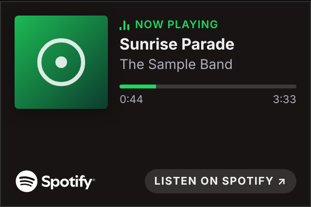
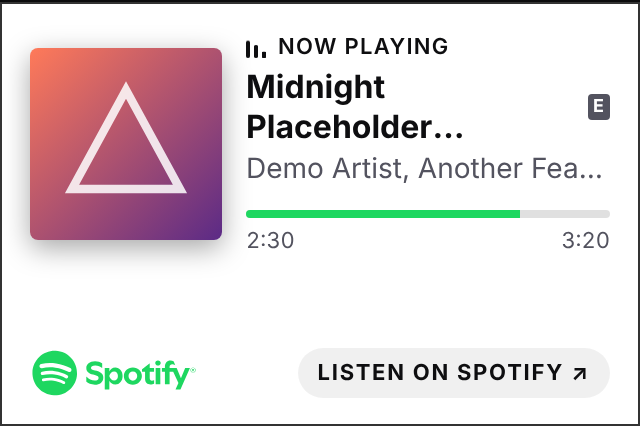
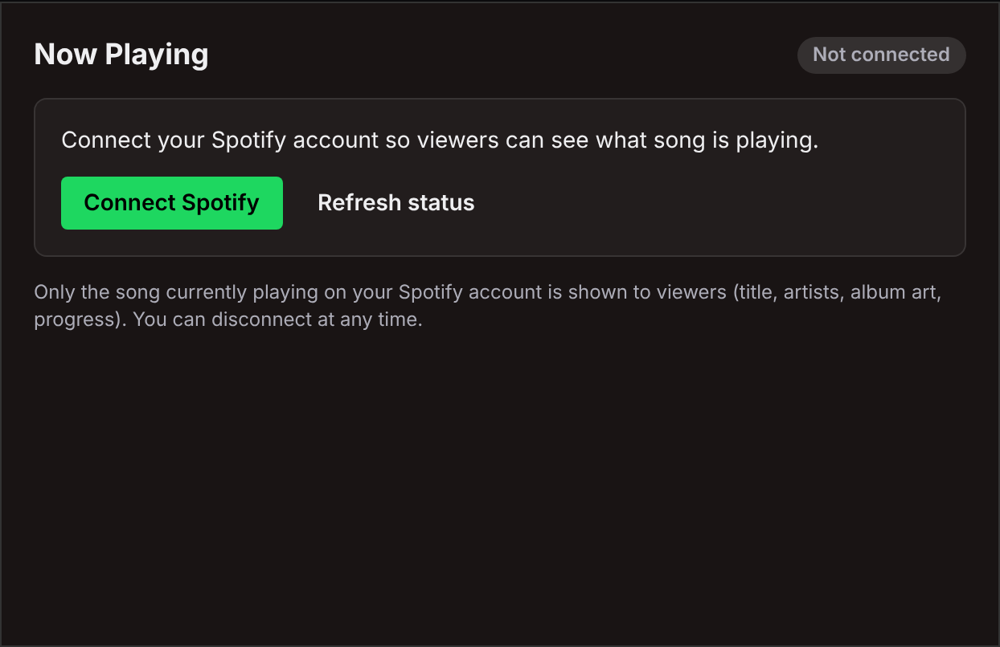
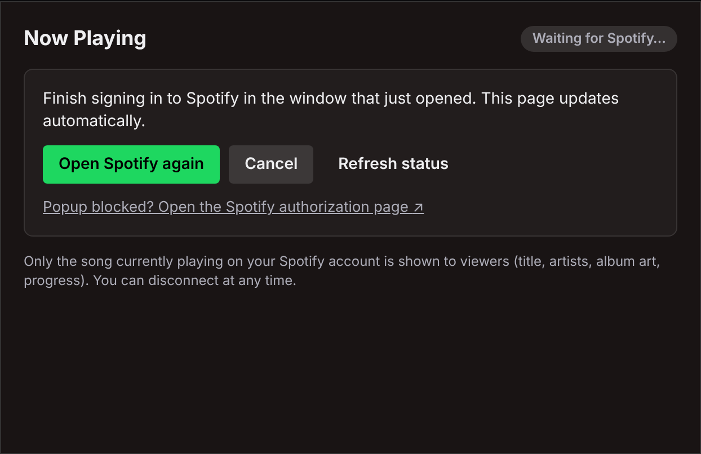
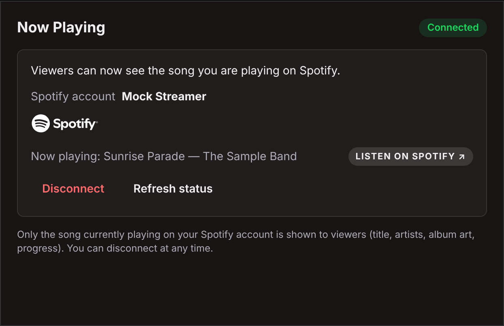
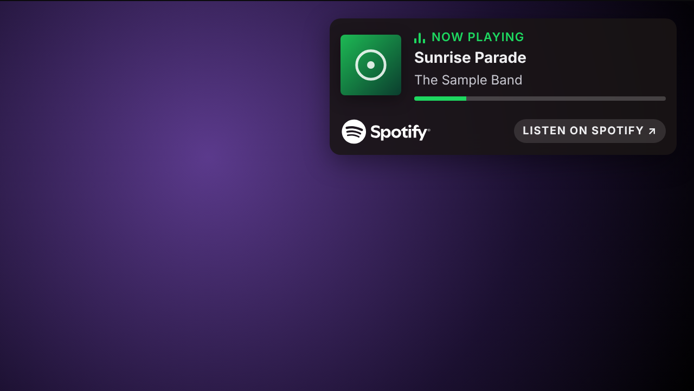
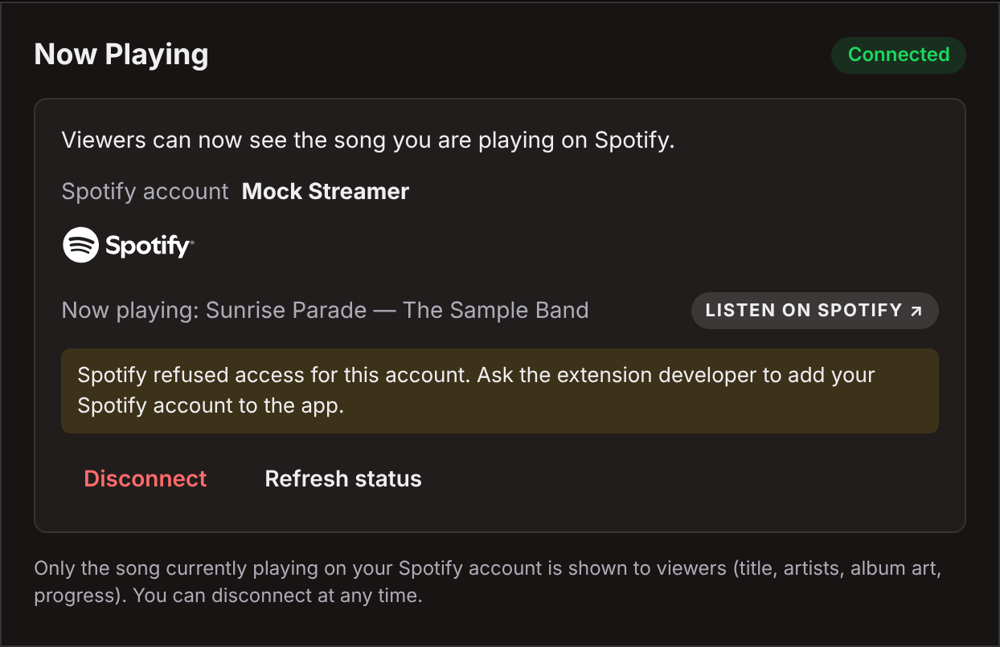

# Build your own Spotify "Now Playing" Twitch extension: step by step

This guide takes you from nothing to a working extension on your own Twitch channel. It uses the code in this
repository unchanged. You only create accounts, fill in settings and run a few commands.

*Leer en español: [GUIDE.es.md](GUIDE.es.md)*

**Placeholders used throughout.** Replace them with your own values:

| Placeholder | What it is | Where you get it |
|---|---|---|
| `<your-app>` | Your Fly.io app name. Your backend URL becomes `https://<your-app>.fly.dev` | You choose it (step 4) |
| `YOUR_SPOTIFY_CLIENT_ID` | Client ID of your Spotify app | Spotify dashboard (step 2) |
| `YOUR_TWITCH_EXTENSION_CLIENT_ID` | Client ID of your Twitch extension | Twitch developer console (step 3) |
| `YOUR_TWITCH_USER_ID` | Numeric Twitch user ID of the account that owns the extension | Step 3.8 |

Never commit or share the **Spotify client secret**, the **Twitch extension secret** or the **token encryption key**.

## Contents
1. [Prerequisites](#1-prerequisites)
2. [Create the Spotify app](#2-create-the-spotify-app)
3. [Create the Twitch extension](#3-create-the-twitch-extension)
4. [Deploy the backend to Fly.io](#4-deploy-the-backend-to-flyio)
5. [Package the frontend](#5-package-the-frontend)
6. [Local development and testing](#6-local-development-and-testing)
7. [Install on your channel and connect Spotify](#7-install-on-your-channel-and-connect-spotify)
8. [Troubleshooting](#8-troubleshooting)
9. [Updating and redeploying](#9-updating-and-redeploying)
10. [Known limits and policy notes](#10-known-limits-and-policy-notes)

---

## 1. Prerequisites

- **A Twitch account with two-factor authentication (2FA)** turned on. The developer console requires it.
- **A Spotify account with Premium.** The owner of a Spotify app in Development Mode must have Premium, or the app
  stops working. The streamers who link their accounts don't need Premium.
- **A Fly.io account with a credit card** on file. The free trial stops machines after a few minutes, which doesn't
  work for a backend that has to keep polling. One small machine plus a 1 GB volume costs a few dollars a month; check
  [Fly.io pricing](https://fly.io/docs/about/pricing/).
- **Node.js 20.6 or newer** and **git** on your computer.
- **Google Chrome or Chromium**, only if you want to run the frontend's end-to-end tests.
- **OpenSSL** (preinstalled on macOS and most Linux distributions) to generate the encryption key.
- A copy of this repository:
  ```bash
  git clone https://github.com/<your-user>/playing-sp.git
  cd playing-sp
  ```

---

## 2. Create the Spotify app

1. Sign in at the [Spotify Developer Dashboard](https://developer.spotify.com/dashboard) with the **Premium** account
   that will own the app.
2. Click **Create app** and fill in:
   - **App name** and **App description**: anything you like.
   - **Redirect URIs**: add exactly
     ```
     https://<your-app>.fly.dev/auth/spotify/callback
     ```
     You choose `<your-app>` in step 4, so pick the name now. It must match the backend's `SPOTIFY_REDIRECT_URI`
     character for character. Spotify requires HTTPS and doesn't accept `localhost`. For local testing you can also add
     a loopback address such as `http://127.0.0.1:8787/auth/spotify/callback` (see step 6.3 and Spotify's
     [redirect URI rules](https://developer.spotify.com/documentation/web-api/concepts/redirect_uri)).
   - **Which API/SDKs are you planning to use?**: select **Web API**.
   - Accept the terms and save.
3. Open the app's **Settings** and copy the **Client ID** (`YOUR_SPOTIFY_CLIENT_ID`) and the **Client secret**. You'll
   set both on the backend in step 4. Keep the secret private.
4. Open **User Management** and add every streamer who will link Spotify, with their name and the email of their
   Spotify account. The app owner is already allowed.
   - **Development Mode allows at most 5 users per app.** Anyone not on the list can still sign in, but Spotify
     answers the backend's requests with **403**. The config page then says "Spotify refused access for this account".
   - Going beyond 5 users requires Spotify's Extended Quota Mode, which is only granted to organizations that meet
     Spotify's criteria. See [Quota modes](https://developer.spotify.com/documentation/web-api/concepts/quota-modes).

The backend asks for two read-only scopes: `user-read-currently-playing` and `user-read-playback-state`. It never
controls playback.

---

## 3. Create the Twitch extension

The console tabs and field names below come from Twitch's
[Extensions Life Cycle Management](https://dev.twitch.tv/docs/extensions/life-cycle/) page.

1. Open the [Twitch developer console → Extensions](https://dev.twitch.tv/console/extensions) and click
   **Create Extension**. Give it a name. This creates the first version (for example `0.0.1`) in **Local Test**.
2. Open the version and click **Manage** to reach the Extensions Manager (tabs: Status, Version Details, Capabilities,
   Monetization, Files, Asset Hosting, Access).
3. **Asset Hosting** tab:
   - **Type of Extension**: tick **Panel**, **Video - Fullscreen** and **Video - Component** (or only the ones you
     want).
   - **Panel Viewer Path**: `panel.html`, **Panel Height**: `210`.
   - **Video - Fullscreen** viewer path: `video_overlay.html`.
   - **Video - Component** viewer path: `video_component.html`.
   - **Config Path**: `config.html`.
   - **Live Config Path**: `live_config.html`.
   - **Testing Base URI**: only used in Local Test (step 6.3). The default `https://localhost:8080/` is fine.
   - Paths are relative to the root of the zip. No leading folder.
4. **Capabilities** tab:
   - **Allowlist for URL Fetching Domains**: `https://<your-app>.fly.dev` (your backend).
   - **Allowlist for Image Domains**: `https://i.scdn.co` (Spotify album and podcast art).
   - **Allowlist for Media Domains**: leave empty.
   - **Allowlist Config URLs**: `https://accounts.spotify.com` (the Spotify login popup) and `https://open.spotify.com`
     (the config page's link back to the current song).
   - **Allowlisted Panel URLs**: `https://open.spotify.com` (the "LISTEN ON SPOTIFY" link).
   - **Request Identity Link**: No. **Chat Capabilities**: No.
   - **Select how you will configure your Extension**: choose **No configuration**. The console's default is the
     Twitch-hosted *Extensions Configuration Service*, which this project doesn't use, so change it.
   - *Optional:* if you want Twitch to allow activation only after Spotify is linked, choose **Custom/My Own Service**
     and enter the required configuration string `spotify-linked-v1`. Then set the same string in the backend's
     `TWITCH_REQUIRED_CONFIGURATION` and the version number (for example `0.0.1`) in `TWITCH_EXTENSION_VERSION`
     (step 4.5). After a successful link the backend sets this string for the channel through the Twitch API, and the
     config page shows "Finishing setup with Twitch…" until it's done.
5. **Monetization** tab: **Bits support: No**, **Subscription support: No**. These fields must be saved before
   Hosted Test.
6. **Access** tab (optional): add the numeric user IDs of other accounts that should be able to test. Your own
   account can always test.
7. **Extension settings → Secret Keys**: copy the **Key** (base64). This is the extension secret for the backend's
   `TWITCH_EXTENSION_SECRET`. Copy the extension's **Client ID** too (`YOUR_TWITCH_EXTENSION_CLIENT_ID`); it's shown
   on the extension's overview and settings pages. See
   [Managing Extension Secrets](https://dev.twitch.tv/docs/extensions/building/). Keep the secret private.
8. **Your numeric Twitch user ID** (`YOUR_TWITCH_USER_ID`), for `TWITCH_EXTENSION_OWNER_ID`: this is a number, not
   your login name. Look it up with the [Twitch CLI](https://dev.twitch.tv/docs/cli/) (`twitch api get users -q
   login=<your-login>`) or the Helix [Get Users](https://dev.twitch.tv/docs/api/reference/#get-users) endpoint.

**Local Test vs Hosted Test**
- **Local Test**: Twitch loads the extension files from your own web server at the Testing Base URI. You can change
  every setting in this state.
- **Hosted Test**: Twitch serves the files you uploaded as a zip from its CDN, exactly as in production. Only your
  test accounts can see the extension.
- **To change any version setting (paths, allowlists, capabilities) you must move the version back to Local Test.**
  In Hosted Test those fields are greyed out.

You upload the zip in step 5 and move to Hosted Test in step 7.

---

## 4. Deploy the backend to Fly.io

[DEPLOY.md](DEPLOY.md) has the same steps with extra detail (costs, alternatives, token migration). The short version:

### 4.1 Install flyctl and log in
```bash
curl -L https://fly.io/install.sh | sh     # macOS/Linux (macOS alternative: brew install flyctl)
# Windows (PowerShell): pwsh -Command "iwr https://fly.io/install.ps1 -useb | iex"
fly auth login
```
See [Install flyctl](https://fly.io/docs/flyctl/install/).

### 4.2 Create the app
The repository already contains `backend/fly.toml`, so create the app directly instead of generating a new config:
```bash
cd backend
fly apps create <your-app>
```
Then open `backend/fly.toml` and replace the `<your-app>` placeholder in `app = "<your-app>"` with your app name.
Run the `fly` commands from `backend/` (or add `--app <your-app>` to each, as [DEPLOY.md](DEPLOY.md) does). The name must be globally unique and becomes
`https://<your-app>.fly.dev`. `primary_region` is set to `sjc`; change it if you prefer another region (list them with
`fly platform regions`).

*Alternative:* if you prefer `fly launch`, run `fly launch --copy-config --no-deploy --name <your-app>` so it keeps
the existing `fly.toml` and doesn't deploy yet. Afterwards check that `fly.toml` still has the `[mounts]` section and
the right `app` name.

### 4.3 Create the volume
The encrypted token store lives in `/data` on a volume. Create it once, in the same region as `primary_region`:
```bash
fly volumes create ebs_data --region sjc --size 1
```
Accept the warning about a single volume: this app is designed to run as one machine.

### 4.4 Know what's already in `fly.toml`
`[env]` already sets `NODE_ENV=production`, `HOST=0.0.0.0`, `PORT=8080`, `DATA_DIR=/data`, `LOG_LEVEL=info`,
`TWITCH_LOCAL_TEST_ORIGINS=""` (turns off the Local Test CORS origin in production), `SPOTIFY_USE_PKCE=true` and
`POLLER_ENABLED=true`. It also mounts the volume at `/data`, health-checks `GET /healthz` and keeps one machine always
running. Don't put secrets in `fly.toml`.

### 4.5 Set the secrets and settings
Every variable is described in [`backend/.env.example`](backend/.env.example).

| Variable | Value | Secret? |
|---|---|---|
| `SPOTIFY_CLIENT_ID` | `YOUR_SPOTIFY_CLIENT_ID` | no |
| `SPOTIFY_CLIENT_SECRET` | Spotify app client secret | **yes** |
| `SPOTIFY_REDIRECT_URI` | `https://<your-app>.fly.dev/auth/spotify/callback` (must match the Spotify app exactly) | no |
| `PUBLIC_BASE_URL` | `https://<your-app>.fly.dev` | no |
| `TWITCH_EXTENSION_CLIENT_ID` | `YOUR_TWITCH_EXTENSION_CLIENT_ID` | no |
| `TWITCH_EXTENSION_SECRET` | The base64 key from **Secret Keys**, exactly as shown | **yes** |
| `TWITCH_EXTENSION_OWNER_ID` | `YOUR_TWITCH_USER_ID` | no |
| `TOKEN_ENCRYPTION_KEY` | 32 random bytes: `openssl rand -base64 32` | **yes** |
| `CORS_ALLOWED_ORIGINS` | `https://YOUR_TWITCH_EXTENSION_CLIENT_ID.ext-twitch.tv` (also the default when unset) | no |
| `TWITCH_EXTENSION_VERSION` | Optional. Your extension version, e.g. `0.0.1`; only needed with required configuration | no |
| `TWITCH_REQUIRED_CONFIGURATION` | Optional. `spotify-linked-v1` only if you chose Custom/My Own Service | no |

**CORS:** Twitch serves your extension from `https://YOUR_TWITCH_EXTENSION_CLIENT_ID.ext-twitch.tv` in Hosted Test
and after release. The backend only answers browser requests from origins in `CORS_ALLOWED_ORIGINS` (default: exactly
that origin) plus `TWITCH_LOCAL_TEST_ORIGINS` (empty in production).

Set the values without deploying yet (`--stage`). Type the secret values yourself, and start the line with a space if
your shell is set to keep such lines out of history:
```bash
fly secrets set SPOTIFY_CLIENT_ID=YOUR_SPOTIFY_CLIENT_ID \
  SPOTIFY_REDIRECT_URI=https://<your-app>.fly.dev/auth/spotify/callback \
  PUBLIC_BASE_URL=https://<your-app>.fly.dev \
  TWITCH_EXTENSION_CLIENT_ID=YOUR_TWITCH_EXTENSION_CLIENT_ID \
  TWITCH_EXTENSION_OWNER_ID=YOUR_TWITCH_USER_ID \
  CORS_ALLOWED_ORIGINS=https://YOUR_TWITCH_EXTENSION_CLIENT_ID.ext-twitch.tv --stage
 fly secrets set SPOTIFY_CLIENT_SECRET='<type it>' TWITCH_EXTENSION_SECRET='<type it>' \
  TOKEN_ENCRYPTION_KEY="$(openssl rand -base64 32)" --stage
```
You can also use `fly secrets import` and paste `NAME=value` lines, or the app's **Secrets** page in the Fly.io
dashboard. See [Secrets](https://fly.io/docs/apps/secrets/).

**Keep `TOKEN_ENCRYPTION_KEY` stable.** It encrypts the stored Spotify tokens. If you change it or lose the volume,
every streamer has to connect Spotify again.

The backend checks its configuration at startup and refuses to start with a clear error if a required variable is
missing, the redirect URI isn't HTTPS, or the key has the wrong length.

### 4.6 Deploy and check
```bash
fly deploy --ha=false     # one machine only: the token store is a single file
fly status                # expect 1 machine, started, checks passing
fly logs                  # expect "EBS listening on http://0.0.0.0:8080"
curl -i https://<your-app>.fly.dev/healthz     # expect HTTP 200 and {"ok":true}
```

Optional CORS check. The first request should return `access-control-allow-origin` with your extension origin; the
second, from an unlisted origin, should not:
```bash
curl -si -X OPTIONS https://<your-app>.fly.dev/api/now-playing \
  -H "Origin: https://YOUR_TWITCH_EXTENSION_CLIENT_ID.ext-twitch.tv" \
  -H "Access-Control-Request-Method: GET" | grep -i access-control-allow-origin
curl -si -X OPTIONS https://<your-app>.fly.dev/api/now-playing \
  -H "Origin: https://example.com" -H "Access-Control-Request-Method: GET" | grep -i access-control-allow-origin
```
A request without a token to `https://<your-app>.fly.dev/api/now-playing` should return `401` with `missing_token`.

---

## 5. Package the frontend

```bash
cd frontend
npm install
EBS_BASE_URL=https://<your-app>.fly.dev npm run package
```
- The zip lands in `frontend/release/now-playing-frontend-<version>.zip` (about 47 KB, 15 files, HTML files at the
  root of the zip).
- The frontend scripts don't load `.env` files. Pass `EBS_BASE_URL` on the command line as above;
  `frontend/.env.example` only lists the available variables for reference.
- `EBS_BASE_URL` is built into the files, and it must start with `https://`. **If your backend URL ever changes, you
  must package and upload again.**
- The script refuses to write the zip if a check fails: helper script not first, inline or remote scripts, `eval`,
  source maps, dev/mock code, absolute paths, file names with spaces, or a modified Spotify logo.

Upload it: Twitch console → your version (in **Local Test**) → **Files** tab → **Upload Version Assets** → choose the
zip. Upload the zip exactly as produced; don't unzip and re-zip it.

---

## 6. Local development and testing

### 6.1 Mock harness (no accounts needed)
```bash
cd frontend
npm install
npm run dev      # harness: http://localhost:8081/   mock backend: http://localhost:8090
```
The harness shows all five views side by side, with a mock Twitch helper and a mock backend, and serves them with a
Twitch-like Content Security Policy so mistakes show up locally. Buttons let you play sample tracks, pause, seek, show
an ad or nothing playing, switch dark/light theme, add stream delay, make the backend fail or slow, and walk through
the Connect Spotify flow with a fake consent page. A single view can be opened directly, e.g.
`http://localhost:8081/panel.html?theme=light`.

 

### 6.2 Tests
```bash
cd frontend
npm test                    # unit tests
npm run test:e2e            # headless Chrome end-to-end tests; writes screenshots to frontend/.screenshots/ (gitignored)
npm run test:integration    # the real backend (on port 8787) with its mock Spotify/Twitch + the harness

cd ../backend
npm test                    # backend unit + integration tests (mocked Spotify/Twitch)
npm run smoke               # real server + mock upstreams + curl
```
The e2e tests use your system Chrome; set `CHROME_PATH` if it isn't found. The dev server, e2e and integration tests
each use their own ports and build folders, so they can run at the same time.

### 6.3 Twitch Local Test with a local backend
Use this to try the extension inside Twitch before uploading anything. Both the backend and Twitch's default Testing
Base URI use port **8080**, so run the backend on **8787**.

1. **Backend** (`backend/.env`, copied from `.env.example`):
   ```
   PORT=8787
   SPOTIFY_CLIENT_ID=YOUR_SPOTIFY_CLIENT_ID
   SPOTIFY_CLIENT_SECRET=...
   SPOTIFY_REDIRECT_URI=http://127.0.0.1:8787/auth/spotify/callback
   TWITCH_EXTENSION_CLIENT_ID=YOUR_TWITCH_EXTENSION_CLIENT_ID
   TWITCH_EXTENSION_SECRET=...
   TWITCH_EXTENSION_OWNER_ID=YOUR_TWITCH_USER_ID
   TOKEN_ENCRYPTION_KEY=...           # npm run gen-secrets prints a fresh one
   CORS_ALLOWED_ORIGINS=https://YOUR_TWITCH_EXTENSION_CLIENT_ID.ext-twitch.tv
   TWITCH_LOCAL_TEST_ORIGINS=https://localhost:8080
   ```
   Add `http://127.0.0.1:8787/auth/spotify/callback` to your Spotify app's Redirect URIs. `TWITCH_LOCAL_TEST_ORIGINS`
   lets the Local Test origin through CORS; its default is already `https://localhost:8080`, so change it only if your
   Testing Base URI is different. Then start the backend with `npm start`.
2. **Frontend build for Local Test** (this build is only for Local Test and is never uploaded):
   ```bash
   cd frontend
   node scripts/build.mjs --dev --out dist --ebs http://localhost:8787
   ```
3. **Serve `frontend/dist/` over HTTPS on port 8080**, matching the Testing Base URI `https://localhost:8080/`. Twitch
   requires HTTPS here, so create a self-signed certificate and use any static server that supports TLS, for example:
   ```bash
   openssl req -x509 -newkey rsa:2048 -nodes -keyout key.pem -out cert.pem -days 30 -subj /CN=localhost
   npx http-server dist -S -C cert.pem -K key.pem -p 8080
   ```
   Open `https://localhost:8080/panel.html` once in your browser and accept the certificate, or Twitch can't load it.
4. With the version in **Local Test**, install it on your channel and connect Spotify as in step 7.

Twitch serves your own files in Local Test, so allowlist and CSP behavior may differ between Local Test and Hosted Test;
check [Twitch's current docs](https://dev.twitch.tv/docs/extensions/life-cycle/) and test in Hosted Test before release. The production
backend on Fly.io doesn't allow the Local Test origin (its `TWITCH_LOCAL_TEST_ORIGINS` is empty), which is why Local
Test needs this local backend.

---

## 7. Install on your channel and connect Spotify

1. **Move to Hosted Test.** After uploading the zip (step 5), open the **Status** tab and move the version to
   **Hosted Test**.
2. **Install.** Open your creator dashboard → **Extensions** → **My Extensions** (or use the console's "View on Twitch
   and Install") and install the extension.
3. **Configure.** Open the extension's **Configure** page. You see the config view:

   

4. **Connect Spotify.** Click **Connect Spotify**. A popup opens on `accounts.spotify.com` (allow popups for
   twitch.tv if your browser blocks it). Sign in and approve. The popup closes itself after a moment, and the config
   page switches to **Connected** within a few seconds:

   
   

   If you enabled required configuration, you briefly see "Finishing setup with Twitch…" first.
5. **Activate.** Activate the extension as a **Panel**, and if you like as an **Overlay** (Video - Fullscreen) or a
   **Component**.
6. **Play something on Spotify.** The panel updates within a few seconds:

   

Remember: in Local Test and Hosted Test only your test accounts see the extension. Your viewers see it after Twitch
reviews and approves the version and you release it. For review you'll also need an icon, a discovery image,
screenshots, and privacy policy and terms URLs (Version Details tab).

---

## 8. Troubleshooting

**Fields are greyed out in the console.** The version is in Hosted Test (or later). Move it back to **Local Test** on
the Status tab, make the change, upload the zip again if needed, and move it back to Hosted Test.

**CORS errors in the browser console** ("blocked by CORS policy").
- The backend only allows `CORS_ALLOWED_ORIGINS` (default `https://YOUR_TWITCH_EXTENSION_CLIENT_ID.ext-twitch.tv`)
  plus `TWITCH_LOCAL_TEST_ORIGINS`. Check `TWITCH_EXTENSION_CLIENT_ID` is right, and run the curl check from step 4.6.
- In Local Test the origin is your Testing Base URI (`https://localhost:8080`), which production deliberately refuses.
  Use a local backend (step 6.3).
- An error that mentions **Content Security Policy** / `connect-src` isn't CORS: your backend URL is missing from
  **Allowlist for URL Fetching Domains**, or the zip was packaged with a different `EBS_BASE_URL`.

**Redirect URI mismatch.** Spotify shows an error such as "INVALID_CLIENT: Invalid redirect URI". The backend's
`SPOTIFY_REDIRECT_URI` must match one of the Redirect URIs in your Spotify app exactly: scheme, host, path, no
trailing slash. For Fly.io it's `https://<your-app>.fly.dev/auth/spotify/callback`. After changing the secret, Fly
restarts the app automatically.

**Spotify returns 403 / "Spotify refused access for this account".** The Spotify account that linked isn't in your
Spotify app's **User Management**, or the app already has 5 users (the Development Mode cap). Add the account (or
remove an unused one), then click **Refresh status**, or disconnect and connect again. Also check the app owner's
Premium is active.



**"Spotify is temporarily limiting requests".** Spotify's rate limit (HTTP 429) or the Development Mode quota
(`QUOTA_EXCEEDED`) was hit. The backend waits as long as Spotify's `Retry-After` asks, or 10 minutes for quota, and
then resumes automatically. All your Development Mode apps share one quota, so other apps you own count too. By default
only viewed channels are polled (`POLL_ONLY_WHEN_VIEWED=true`), which keeps usage low.

**"Not connected" after linking.**
- Check the popup's message: it says whether linking succeeded, was cancelled, or expired (the link is valid for 10
  minutes). Try again from Configure.
- Make sure the uploaded zip points at the backend you linked with. A zip packaged for an old URL talks to a backend
  that has no link for your channel. Repackage (step 5) and upload.
- If it worked before and stopped after a redeploy, the volume may be missing (tokens are stored in `/data`) or
  `TOKEN_ENCRYPTION_KEY` changed. Fix it and connect again.
- "Connection lost" / "Reconnect Spotify" means Spotify revoked the access (for example, you removed the app in your
  Spotify account settings). Connect again.

**Stale song or album art.**
- With stream-delay sync, viewers see changes after their broadcast delay (up to 30 s) on purpose, so the card
  matches what they hear.
- If a channel wasn't viewed for about 10 minutes, the backend pauses polling. The first viewer who opens it wakes it
  up, and the first answer can take a few seconds.
- If the art shows a placeholder instead of the cover, add `https://i.scdn.co` to **Allowlist for Image Domains**.
- Check `fly logs` for Spotify or PubSub errors, and reload the page.

**Zip upload rejected.** Upload the zip created by `npm run package` as is. The HTML files must be at the **root** of
the zip (not inside a folder), file names can't contain spaces, and only asset files are allowed. Re-zipping the
folder yourself usually adds a top-level directory.

**The backend doesn't start.** Run `fly logs`. The backend prints exactly which variable is missing or invalid.

---

## 9. Updating and redeploying

**Backend code or settings**
```bash
git pull
cd backend
fly deploy --ha=false
```
Changing a secret with `fly secrets set` (without `--stage`) restarts the app with the new value. Keep the volume and
`TOKEN_ENCRYPTION_KEY` so streamers stay connected.

**Frontend**
1. `cd frontend && EBS_BASE_URL=https://<your-app>.fly.dev npm run package`.
2. If the version is in test: move it back to **Local Test**, upload the new zip on the **Files** tab, then move it to
   **Hosted Test** again.
3. A **released** version can't be changed. Create a new version in the console (it copies the previous settings),
   upload the zip, test it and submit it for review. If you use required configuration, update
   `TWITCH_EXTENSION_VERSION` to the new version number.

**If the backend URL changes** (new app name or custom domain), update all of these:
- the Spotify app's Redirect URI,
- the backend's `SPOTIFY_REDIRECT_URI` and `PUBLIC_BASE_URL`,
- **Allowlist for URL Fetching Domains** (back in Local Test),
- and repackage and upload the frontend with the new `EBS_BASE_URL`.

---

## 10. Known limits and policy notes

This is not legal advice. Read the policies yourself before publishing. More detail:
[docs/PLATFORM_NOTES.md](docs/PLATFORM_NOTES.md), [backend/README.md](backend/README.md) (platform constraints) and
[frontend/TWITCH_COMPLIANCE.md](frontend/TWITCH_COMPLIANCE.md).

- **Spotify Developer Policy.** The [Developer Policy](https://developer.spotify.com/policy) limits commercial use and
  says: "Do not synchronize any sound recordings with any visual media, including … video" and "Do not create any
  product or service which is integrated with streams or content from another service." This project only shows
  metadata and plays no audio, but a Twitch integration could still be read as falling under these rules. Check the
  policy and consider asking Spotify for approval before a public release.
- **Spotify Design and Branding.** Spotify metadata must come with Spotify branding and link back to Spotify
  ([Design guidelines](https://developer.spotify.com/documentation/design)). The official logo is bundled unmodified
  (the package step checks it), and the link reads "LISTEN ON SPOTIFY".
- **Development Mode.** The app owner needs Premium, at most 5 users, one shared quota for all your Development Mode
  apps ([Quota modes](https://developer.spotify.com/documentation/web-api/concepts/quota-modes)).
- **Twitch guideline 6.2.2.** No Bits for playing a specific song ("jukebox-like functionality")
  ([Guidelines & Policies](https://dev.twitch.tv/docs/extensions/guidelines-and-policies/)). This project has no Bits
  features.
- **Twitch guideline 2.13.** Public hosted domains should have a unique identifier or be your own domain. Use your
  stable `https://<your-app>.fly.dev` URL or a custom domain, never a temporary tunnel URL.
- **Review timing.** Test versions are only visible to test accounts. Your viewers need a reviewed, approved and
  released version, and review takes time. See [Life cycle](https://dev.twitch.tv/docs/extensions/life-cycle/).
- **One instance.** Run a single backend machine; the token store and poller aren't built for more.

**Official docs:** [Twitch Extensions](https://dev.twitch.tv/docs/extensions/) ·
[Twitch Guidelines & Policies](https://dev.twitch.tv/docs/extensions/guidelines-and-policies/) ·
[Spotify Developer Policy](https://developer.spotify.com/policy) ·
[Spotify Design guidelines](https://developer.spotify.com/documentation/design) ·
[Spotify Quota modes](https://developer.spotify.com/documentation/web-api/concepts/quota-modes) ·
[Fly.io docs](https://fly.io/docs/)
