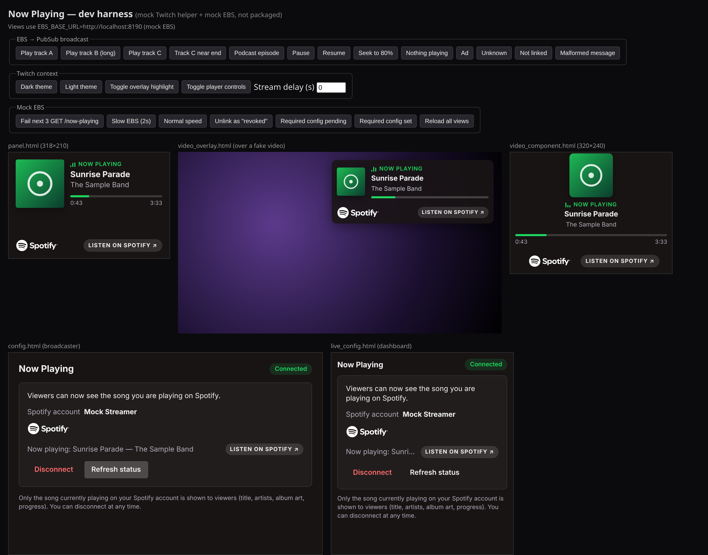
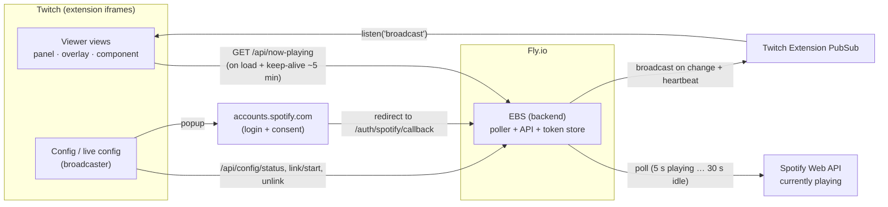

# Now Playing on Spotify: a Twitch extension you can build yourself

A complete, working example of a Twitch extension that shows viewers the song (or podcast episode) the
streamer is playing on Spotify right now: album art, title, artists, a live progress bar and a
"LISTEN ON SPOTIFY" link. It comes with a small backend (an *Extension Backend Service*, EBS) that you
deploy to Fly.io, a zero-config mock harness for local development, and tests.

Use it as a **guide and starting point** for your own extension. It's not a hosted product: you create your
own Spotify app, your own Twitch extension and your own backend.

➡️ **Step-by-step guide:** [GUIDE.md](GUIDE.md) · **Guía paso a paso en español:** [GUIDE.es.md](GUIDE.es.md)

> **Limits:** Spotify apps in Development Mode are limited to **5 Spotify users**, and the app owner needs **Spotify
> Premium** ([Quota modes](https://developer.spotify.com/documentation/web-api/concepts/quota-modes)). Twitch forbids
> using Bits for song requests or jukebox-style features (guideline 6.2.2,
> [Extension Guidelines & Policies](https://dev.twitch.tv/docs/extensions/guidelines-and-policies/)), and Spotify
> restricts commercial use ([Developer Policy](https://developer.spotify.com/policy)). Details in
> [Known limits and policy notes](#known-limits-and-policy-notes).



*All screenshots come from the mock harness, with made-up songs and placeholder artwork.*

## Features

**Viewer views** (panel, video overlay, video component)
- Album or podcast art, title, artists and an "E" badge for explicit tracks.
- Progress bar interpolated locally between updates, using the backend's clock (`serverTime`), so a viewer's wrong
  clock doesn't matter.
- Clear states: loading, not connected, nothing playing, paused, ad, error with automatic retry.
- Dark and light Twitch themes. The official Spotify logo is bundled unmodified, with a "LISTEN ON SPOTIFY ↗" link
  back to the item.
- Optional stream-delay sync: live updates are applied after the viewer's broadcast delay (up to 30 s) so the card
  matches what the viewer hears.

**Broadcaster views** (config, live config)
- "Connect Spotify" opens the Spotify login in a popup. The page polls the backend until the link is confirmed.
- Shows the linked Spotify account and the current song, and has Disconnect (with an inline confirmation) and Refresh.
- Explains problems in plain language: access revoked, account not allowed by the Spotify app, Spotify rate limits.
- Optional support for Twitch "required configuration" ("Finishing setup with Twitch…").

**Backend (EBS)**
- Node.js 20.6+ with **zero runtime dependencies**. Deployed as one small always-on Fly.io machine with a volume.
- Spotify OAuth (Authorization Code + PKCE). Tokens are encrypted at rest (AES-256-GCM) and refreshed automatically.
- Adaptive polling of Spotify's *currently playing* endpoint: faster while playing, slower while paused or idle,
  backing off on errors, rate limits and quota. By default it only polls channels whose extension is being viewed.
- Optional channel allowlist (`ALLOWED_CHANNEL_IDS`): restrict the backend to specific Twitch channels; all others get
  `403 channel_not_allowed` ("This extension is private.") and are never polled.
- Publishes changes to viewers through Twitch Extension PubSub and respects Twitch's message limits.

**Developer experience**
- `npm run dev` starts a harness with a mock Twitch helper and a mock backend. No keys needed.
- Unit, headless-browser end-to-end and backend integration tests.
- `npm run package` builds, validates (Twitch security rules, no inline scripts, unmodified logos) and zips the frontend.

## Architecture



1. **Linking:** the broadcaster clicks *Connect Spotify* in the config view. The backend returns a Spotify authorize
   URL (`POST /api/config/link/start`), the popup goes to `accounts.spotify.com`, and Spotify redirects to
   `https://<your-app>.fly.dev/auth/spotify/callback`. The backend stores the encrypted tokens and the popup closes
   itself. The config view polls `GET /api/config/status` until it reports `linked: true`.
2. **Polling:** the backend polls Spotify for each linked channel that is being viewed and detects changes (new song,
   pause, seek).
3. **Broadcast:** on each change (plus a 60 s heartbeat while playing), the backend sends the new state to every viewer
   through Twitch Extension PubSub.
4. **Load and keep-alive:** every viewer view calls `GET /api/now-playing` when it loads and about every 5 minutes
   while visible. This gives the first state immediately and tells the backend the channel is still being watched.

Every request carries the Twitch extension JWT, which the backend verifies with the extension secret. The full HTTP and
payload contract is in [API_CONTRACT.md](API_CONTRACT.md).

## Repository layout

```
.
├── README.md             this file
├── GUIDE.md              full setup guide (English)
├── GUIDE.es.md           full setup guide (Spanish)
├── DEPLOY.md             detailed Fly.io deployment
├── API_CONTRACT.md       HTTP + PubSub contract between frontend and backend
├── LICENSE               MIT
├── .gitignore
├── docs/
│   ├── PLATFORM_NOTES.md Spotify and Twitch platform limits and policies
│   └── images/           screenshots used in these docs
├── backend/              the EBS (Node.js, no dependencies)
│   ├── src/              server, routes, OAuth, poller, PubSub, token store
│   ├── test/             node:test suites with mocked Spotify/Twitch
│   ├── scripts/          gen-secrets, mint-jwt, mock-upstreams, smoke.sh
│   ├── .env.example      every environment variable, commented
│   ├── Dockerfile        image used by Fly.io (no secrets inside)
│   ├── fly.toml          Fly.io app config (volume, health check, always on)
│   ├── README.md         backend details, security notes, platform constraints
│   └── DESIGN_FUTURE_BITS.md  why a "Bits song request" feature isn't built
└── frontend/             the Twitch extension (plain HTML/CSS/JS + esbuild)
    ├── src/              panel, video_overlay, video_component, config, live_config
    ├── dev/              mock harness (never shipped)
    ├── scripts/          build, package (validate + zip)
    ├── test/             unit, e2e, integration
    ├── .screenshots/     e2e test output (gitignored, not committed)
    ├── .env.example      reference list of build/test variables (not loaded automatically)
    ├── README.md         frontend details
    └── TWITCH_COMPLIANCE.md  Twitch rules and Spotify branding, with sources
```

## Quick start

Requirements: Node.js 20.6 or newer, and Google Chrome or Chromium for the end-to-end tests.

**Try the frontend with no accounts at all:**
```bash
cd frontend
npm install
npm run dev        # harness at http://localhost:8081/ (mock Twitch + mock backend)
```

**Run the backend tests and smoke test (no real credentials needed):**
```bash
cd backend
npm test           # unit + integration tests against mocked Spotify/Twitch
npm run smoke      # real server + local mock Spotify/Twitch + curl
```

**Ship it for real:** follow [GUIDE.md](GUIDE.md). In short: create a Spotify app, create a Twitch extension, deploy
the backend to `https://<your-app>.fly.dev`, then build the frontend with
`EBS_BASE_URL=https://<your-app>.fly.dev npm run package` and upload the zip in the Twitch developer console.
The frontend scripts don't read `.env` files: pass `EBS_BASE_URL` on the command line as shown
(`frontend/.env.example` only lists the variables for reference).

## Known limits and policy notes

This is not legal advice. Read the policies yourself before publishing anything.

- **Spotify Developer Policy.** The [Spotify Developer Policy](https://developer.spotify.com/policy) restricts
  commercial use and says, among other things: "Do not synchronize any sound recordings with any visual media, including
  … video" and "Do not create any product or service which is integrated with streams or content from another service."
  This project only shows *metadata* (what is playing) and plays no audio, but a Twitch integration could still be read
  as falling under those rules. Check the policy and consider asking Spotify for approval before a public release.
  Playing Spotify music on a stream is a separate matter between the streamer, Spotify's user terms and Twitch's music
  rules.
- **Spotify Design and Branding.** Spotify metadata must be shown with Spotify branding and must link back to Spotify
  ([Design guidelines](https://developer.spotify.com/documentation/design)). The extension bundles the official Spotify
  logo unmodified (the package step fails if the file changes), shows it at more than the 70 px minimum width, and uses
  the "LISTEN ON SPOTIFY" link text.
- **Spotify Development Mode.** New Spotify apps run in Development Mode: the app owner needs Spotify Premium, at most
  **5 Spotify users** can be added in User Management, and all your Development Mode apps share one API quota. Extended
  quota is only available to organizations that meet Spotify's criteria
  ([Quota modes](https://developer.spotify.com/documentation/web-api/concepts/quota-modes)). In practice, one Spotify app
  serves up to 5 streamers.
- **Twitch guideline 6.2.2.** Extensions may not let viewers use Bits "to play a specific musical track … (e.g.,
  jukebox-like functionality)" ([Extension Guidelines & Policies](https://dev.twitch.tv/docs/extensions/guidelines-and-policies/)).
  This project has no Bits features. Don't add a "request a song for Bits" feature.
- **Stable backend domain (Twitch guideline 2.13).** Twitch asks that public hosted domains have a unique identifier or
  be your own domain. Use a stable URL such as `https://<your-app>.fly.dev` or a custom domain. Don't ship a temporary
  tunnel URL: it changes on restart, which would break the packaged extension.
- **Twitch review.** Extensions in Local Test and Hosted Test are only visible to your test accounts. Viewers see the
  extension only after Twitch reviews and approves the version and you release it, so plan time for review
  ([Life cycle](https://dev.twitch.tv/docs/extensions/life-cycle/)).
- **One backend instance.** The token store is a single encrypted file on a Fly volume and the poller runs in-process,
  so run exactly one machine.
- **Private use (optional).** Set `ALLOWED_CHANNEL_IDS` (comma-separated numeric Twitch channel IDs, e.g. `12345678`)
  to make the backend refuse every other channel with `403 channel_not_allowed`. Unset means every channel is allowed.
  It complements Twitch's Streamer Allowlist (Access tab in the developer console, see
  [Life cycle](https://dev.twitch.tv/docs/extensions/life-cycle/)), which limits who can *install* the extension, by also blocking the
  backend. The frontend in this repo has no dedicated "private" screen yet, so blocked channels see a generic error.
  See [backend/README.md](backend/README.md#channel-allowlist-allowed_channel_ids-optional).

More detail: [docs/PLATFORM_NOTES.md](docs/PLATFORM_NOTES.md),
[backend/README.md](backend/README.md) (platform constraints), [frontend/TWITCH_COMPLIANCE.md](frontend/TWITCH_COMPLIANCE.md)
and [API_CONTRACT.md](API_CONTRACT.md).

## Official documentation

- Twitch: [Extensions docs](https://dev.twitch.tv/docs/extensions/) ·
  [Guidelines & Policies](https://dev.twitch.tv/docs/extensions/guidelines-and-policies/) ·
  [Life cycle and console tabs](https://dev.twitch.tv/docs/extensions/life-cycle/) ·
  [Building extensions (secrets, JWT)](https://dev.twitch.tv/docs/extensions/building/)
- Spotify: [Developer Policy](https://developer.spotify.com/policy) ·
  [Design guidelines](https://developer.spotify.com/documentation/design) ·
  [Quota modes](https://developer.spotify.com/documentation/web-api/concepts/quota-modes) ·
  [Redirect URIs](https://developer.spotify.com/documentation/web-api/concepts/redirect_uri) ·
  [Rate limits](https://developer.spotify.com/documentation/web-api/concepts/rate-limits)
- Fly.io: [Docs](https://fly.io/docs/) · [Install flyctl](https://fly.io/docs/flyctl/install/) ·
  [Volumes](https://fly.io/docs/volumes/overview/) · [Secrets](https://fly.io/docs/apps/secrets/) ·
  [Pricing](https://fly.io/docs/about/pricing/)

## License

MIT, see [LICENSE](LICENSE). Spotify and the Spotify logo are trademarks of Spotify AB. Twitch is a trademark of
Twitch Interactive, Inc. This project is not affiliated with or endorsed by either company.
