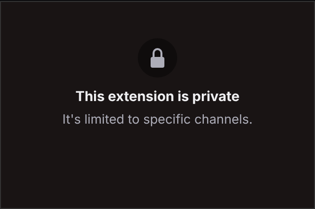
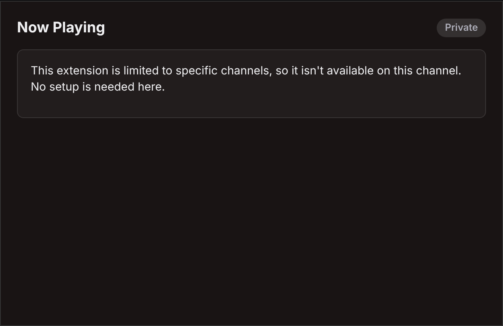

# Twitch "Now Playing on Spotify" – Extension Backend Service (EBS)

Backend for a Twitch extension that shows viewers the song (or podcast episode) the broadcaster is
currently playing on Spotify. Frontend contract: [`../API_CONTRACT.md`](../API_CONTRACT.md).

**What it does**
1. **Links** a broadcaster's Spotify account to their Twitch channel through the OAuth Authorization Code flow.
   It uses the client secret server-side, plus PKCE (S256) and a signed, 10-minute, single-use `state` bound to the
   `channel_id` taken from a **broadcaster-role** Twitch extension JWT.
2. **Stores** tokens in a swappable `TokenStore`. The default `FileTokenStore` is a JSON file with tokens encrypted
   by AES-256-GCM. The access token is refreshed 60 s before it expires; a revoked refresh token (`invalid_grant`)
   marks the link revoked and broadcasts `not_linked`.
3. **Polls** `GET /v1/me/player/currently-playing?additional_types=track,episode` for each channel, adaptively:
   5 s while playing (or just after the current track should end), 10 s during ads, 15 s paused, 30 s idle,
   exponential back-off on errors, and `Retry-After` / `QUOTA_EXCEEDED` handling for 429s.
   By default it **only polls channels whose extension is being viewed** (`POLL_ONLY_WHEN_VIEWED`) to save
   Spotify dev-mode quota.
4. **Detects changes** (state, track/episode, seek > 10 s). It publishes only on change, plus a 60 s heartbeat
   while playing, through **Twitch Helix Extension PubSub** (`broadcast` target) with an EBS-signed JWT. Twitch limits
   are enforced per channel: at least 1 s between messages, no more than 100 per minute, bursts coalesced, 5 KB cap.
5. **Serves** `GET /api/now-playing` (any role) from cache, plus broadcaster config endpoints
   (`/api/config/status`, `/api/config/link/start`, `/api/config/unlink`). Every now-playing payload (HTTP and
   PubSub) carries `serverTime` (EBS clock), so the frontend can compute progress without trusting the viewer's clock.
6. The **OAuth callback page** reports the result to `window.opener` via `postMessage` if the opener is still
   present, then closes its own popup: after 1.5 s on success, 10 s on failure. If the browser refuses to close it,
   the page shows a fallback message and a Close button. Its CSP is nonce-based.
7. Optionally **sets Twitch's required configuration** string after linking (see console setup step 9).

It has **zero runtime dependencies**: Node ≥ 20.6 built-ins only (`http`, `crypto`, `fetch`, `node:test`).

## File tree

```
backend/
├── src/
│   ├── server.js              # entry point (loads .env, starts HTTP + poller)
│   ├── services.js            # composition root (DI of fetch/clock/store for tests)
│   ├── app.js                 # routes, CORS, JWT auth, OAuth link/callback, unlink
│   ├── config.js              # env parsing + validation (redirect URI rules, key length)
│   ├── auth/jwt.js            # HS256 sign/verify (rejects alg≠HS256, checks exp)
│   ├── auth/twitchAuth.js     # Twitch extension JWT verification + role
│   ├── auth/oauthState.js     # signed state + PKCE helpers
│   ├── crypto/secretBox.js    # AES-256-GCM + HKDF subkeys
│   ├── store/tokenStore.js    # TokenStore interface, MemoryTokenStore, FileTokenStore
│   ├── spotify/client.js      # Accounts + Web API client
│   ├── spotify/tokenManager.js# refresh-before-expiry, de-duped refresh, revoke handling
│   ├── spotify/normalize.js   # Spotify response → contract NowPlaying object
│   ├── poller/poller.js       # adaptive per-channel poller, heartbeat, demand-driven
│   ├── poller/changeDetect.js # change detection (state/item/seek)
│   ├── twitch/pubsub.js       # PubSub JWT + request, rate-limited publisher
│   ├── twitch/extensionConfig.js # Helix PUT extensions/required_configuration
│   └── http/util.js           # JSON/HTML responses, errors, rate limiter
├── test/                      # node:test suites with mocked Spotify/Twitch HTTP
├── scripts/
│   ├── gen-secrets.js         # local throwaway TOKEN_ENCRYPTION_KEY / fake extension secret
│   ├── mint-jwt.js            # mint a Twitch-style extension JWT for curl testing
│   ├── mock-upstreams.js      # local mock of Spotify Accounts/Web API + Twitch PubSub
│   └── smoke.sh               # end-to-end smoke test (EBS + mocks + curl)
├── .env.example
├── DESIGN_FUTURE_BITS.md      # design for "spend Bits to queue a song" (not implemented)
└── README.md
```

## How to run

```bash
cd backend
cp .env.example .env            # fill in real values (see console setup below)
npm run gen-secrets             # prints a fresh TOKEN_ENCRYPTION_KEY (and a FAKE extension secret for local tests)
npm start                       # or: npm run dev (auto-restart)
npm test                        # unit + integration tests (mocked upstreams)
npm run smoke                   # end-to-end: real server + mock Spotify/Twitch + curl
```

There is nothing to `npm install`: the backend has no dependencies. It needs Node 20.6 or newer.

Manual curl testing without real credentials:
```bash
# terminal 1: mock upstreams (reads TWITCH_EXTENSION_SECRET from .env to verify PubSub JWTs)
npm run mock-upstreams
# terminal 2: EBS pointed at the mocks
SPOTIFY_ACCOUNTS_BASE=http://127.0.0.1:9090 SPOTIFY_API_BASE=http://127.0.0.1:9090/v1 \
TWITCH_API_BASE=http://127.0.0.1:9090/helix npm start
# terminal 3
B=$(npm run -s mint-jwt -- broadcaster 12345); V=$(npm run -s mint-jwt -- viewer 12345)
curl -s -X POST localhost:8080/api/config/link/start -H "Authorization: Bearer $B"
#   → open the returned authorizeUrl's state in: /auth/spotify/callback?code=x&state=<state>
curl -s localhost:8080/api/now-playing -H "Authorization: Bearer $V"
curl -s -X POST 127.0.0.1:9090/mock/playing -d '{"status":204}'   # change what "Spotify" returns
```

## Environment variables

See [`.env.example`](.env.example) for everything with comments. Required:

| Var | Purpose |
|---|---|
| `SPOTIFY_CLIENT_ID`, `SPOTIFY_CLIENT_SECRET` | Spotify app credentials (server-side only) |
| `SPOTIFY_REDIRECT_URI` | `https://<ebs>/auth/spotify/callback`; must match the dashboard exactly. HTTPS, or `http://127.0.0.1:PORT/...` for local use. `localhost` is rejected. |
| `TWITCH_EXTENSION_CLIENT_ID` | Extension Client ID |
| `TWITCH_EXTENSION_SECRET` | Extension secret, **base64 as shown in the console** (decoded internally) |
| `TWITCH_EXTENSION_OWNER_ID` | Twitch user ID of the extension owner (`user_id` in PubSub JWTs) |
| `TOKEN_ENCRYPTION_KEY` | 32 random bytes (base64/hex). Encrypts tokens at rest and, via HKDF, signs OAuth state |

Optional: `PORT` (8080), `HOST`, `PUBLIC_BASE_URL`, `DATA_DIR` (`./data`), `CORS_ALLOWED_ORIGINS`
(default `https://<client_id>.ext-twitch.tv`), `TWITCH_LOCAL_TEST_ORIGINS` (default `https://localhost:8080`, added
to the CORS list; set empty in production), `TWITCH_EXTENSION_VERSION` + `TWITCH_REQUIRED_CONFIGURATION` +
`TWITCH_REQUIRED_CONFIGURATION_ON_UNLINK` (see "Required configuration" below), `LOG_LEVEL`, `SPOTIFY_USE_PKCE` (true), `TWITCH_PUBSUB_DISABLED`
(log instead of sending), `TWITCH_JWT_CLOCK_TOLERANCE_SEC` (5), `POLL_*`, `HEARTBEAT_INTERVAL_MS`,
`SEEK_THRESHOLD_MS`, `POLL_ONLY_WHEN_VIEWED` (true), `VIEWER_ACTIVITY_WINDOW_MS` (600000),
`API_RATE_LIMIT_PER_MINUTE` (120), `POLLER_ENABLED`, `ALLOWED_CHANNEL_IDS` (see below), and `SPOTIFY_ACCOUNTS_BASE` /
`SPOTIFY_API_BASE` / `TWITCH_API_BASE` (for mocks only).

### Channel allowlist (`ALLOWED_CHANNEL_IDS`, optional)

Comma-separated numeric Twitch channel IDs, e.g. `ALLOWED_CHANNEL_IDS=12345678` or `12345678,87654321`.
Whitespace is trimmed and empty entries are ignored; any non-numeric entry makes startup fail with a config error.
Unset or empty = every channel is allowed (default).

When set, only the listed channels may start linking (`POST /api/config/link/start`), complete it
(`GET /auth/spotify/callback`: the channel bound in the signed state is checked; a blocked channel gets the
self-closing popup page with HTTP 403 and reason `channel_not_allowed`), read `GET /api/config/status`, unlink
(`POST /api/config/unlink`, `DELETE /api/config/link`) and read `GET /api/now-playing`. Everyone else gets
`403 {"version":1,"error":{"code":"channel_not_allowed","message":"This extension is private."}}`. The check runs right
after JWT verification, so missing/invalid/expired tokens still get 401, and before the role check. The poller skips
already-linked channels that are not in the list (no Spotify polling, no PubSub). At startup the EBS logs only the
list size ("Channel allowlist: N channel(s) allowed"), never the IDs.

Unlink is blocked too, for consistency: a channel removed from the list keeps its encrypted tokens in `tokens.json`
but they are never used. To purge them, add the channel back and unlink, or delete the entry from the store.

This complements Twitch's own **Streamer Allowlist** (the **Access** tab of your extension version in the Twitch
developer console, see [Life cycle](https://dev.twitch.tv/docs/extensions/life-cycle/)), which controls which streamers can *install* the released
extension; `ALLOWED_CHANNEL_IDS` makes the backend
refuse everyone else even if the extension is installed somewhere. Find a channel ID with the Twitch API
(`GET /helix/users?login=<name>`) or the `channel_id` claim of an extension JWT.

The frontend shows blocked channels a terminal private state (see `../frontend/README.md` → "Private channels"):




## Required setup: Spotify Developer Dashboard

1. Log in at <https://developer.spotify.com/dashboard> with the account that will **own** the app.
   **That account must have Spotify Premium** or the dev-mode app will not work (rule in force since 9 Mar 2026).
2. **Create app**: set a name and description. Under **Redirect URIs**, add exactly the value of `SPOTIFY_REDIRECT_URI`,
   e.g. `https://ebs.example.com/auth/spotify/callback`. For purely local tests you can add
   `http://127.0.0.1:8080/auth/spotify/callback`. Select **Web API** and accept the terms.
3. **Settings**: copy the Client ID and Client Secret into `.env`.
4. **User Management**: add every broadcaster who will link Spotify (name + Spotify account email).
   **Dev mode allows at most 5 users per app.** Users who are not on the list can log in, but API calls return **403**.
   The EBS then reports `lastError: "spotify_forbidden"` in `/api/config/status`. Authorized users do not need
   Premium. Only the app owner does.
5. Anything beyond 5 users needs **Extended Quota Mode**. Since 15 May 2025, Spotify only accepts that from
   **registered organizations** (with ~250k MAU, a launched service, and a presence in key markets). See Platform constraints.

## Required setup: Twitch Developer Console

1. Go to <https://dev.twitch.tv/console/extensions> and choose **Create Extension**. Pick the types (Panel, Video Overlay,
   and/or Component). A Config view is needed for the broadcaster linking UI.
2. **Extension Settings → Extension Secrets**: copy the secret (base64) into `TWITCH_EXTENSION_SECRET`.
   Copy the Client ID into `TWITCH_EXTENSION_CLIENT_ID`.
3. **Owner ID**: the numeric Twitch user ID of the account that owns the extension. Look it up with
   `twitch api get users -q login=<name>` (Twitch CLI) or Helix Get Users. Put it in `TWITCH_EXTENSION_OWNER_ID`.
4. **Asset Hosting**: the **Testing Base URI** is the *frontend* dev server, not this EBS. Hosted Test must be HTTPS.
5. **Capabilities**:
   - **Allowlist for URL Fetching Domains**: add the EBS origin, e.g. `https://ebs.example.com` or your tunnel URL.
     Without it, the extension CSP blocks calls to the EBS.
   - **Allowlist for Config URLs**: add `https://accounts.spotify.com` so the config view can open the Spotify login.
   - **Image domains** (for the frontend): `https://i.scdn.co` (album and podcast art).
6. **EBS must be HTTPS** for Hosted Test and production. For development, expose the local EBS with a tunnel, e.g.
   `cloudflared tunnel --url http://localhost:8080` or `ngrok http 8080`. Then:
   - set `SPOTIFY_REDIRECT_URI=https://<tunnel>/auth/spotify/callback` and register the same URI in the Spotify dashboard;
   - add the tunnel origin to the URL-fetching allowlist.
   Free tunnels change URL on every restart, so a reserved or named tunnel saves re-registering.
7. **CORS:** `CORS_ALLOWED_ORIGINS` defaults to `https://<client_id>.ext-twitch.tv` (Hosted Test / production).
   **Local Test** loads the frontend from the console's *Testing Base URI* origin, `https://localhost:8080` by
   default. That origin is allowed through `TWITCH_LOCAL_TEST_ORIGINS`, which defaults to `https://localhost:8080`;
   change it if your Testing Base URI differs, and set it empty in production. If the frontend's Local Test server
   runs on 8080 on the same machine, start the EBS on another port (e.g. `PORT=8787`).
   The harness origin (`http://localhost:8081`) goes in `CORS_ALLOWED_ORIGINS` for local dev.
8. **Allowlist for Panel URLs:** add `https://open.spotify.com` (the viewer "Open in Spotify" link uses `item.url`).
9. **Required configuration (optional, automated):** this lets a broadcaster activate the extension only after
   linking Spotify.
   - In **Capabilities → Extension Configuration Service**, select **Custom/My Own Service**.
   - Enter a **Required Configurations** string, e.g. `spotify-linked-v1`.
   - Set the same string in `TWITCH_REQUIRED_CONFIGURATION`, and set `TWITCH_EXTENSION_VERSION` to the version in use
     (e.g. `0.0.1`).
   - After each successful link, the EBS calls Helix
     [`PUT /extensions/required_configuration?broadcaster_id=<id>`](https://dev.twitch.tv/docs/api/reference/#set-extension-required-configuration)
     with body `{extension_id, extension_version, required_configuration}`. It uses an EBS JWT
     `{exp, user_id: <owner>, role: "external"}` and the `Client-Id` header.
   - A failure there never blocks linking. `GET /api/config/status` retries and reports `requiredConfigSet`.
   - **When you release a new extension version**, update `TWITCH_EXTENSION_VERSION`. The value is per version, and
     the EBS re-sends it the next time the broadcaster opens the config page.
   - On **unlink**, the value is left alone by default. Twitch uses it to gate *activation*; changing it for a
     channel that is already active isn't documented to deactivate the extension, and the viewer views show
     `not_linked` anyway. Set `TWITCH_REQUIRED_CONFIGURATION_ON_UNLINK=unlinked` to require re-linking before
     re-activation.
   - If you don't want this automated, leave both vars empty. Choose "None" as the configuration service, or set the
     string manually for each broadcaster, which is impractical.

## Deployment notes

- Run **one instance**. The poller cache, rate limiter, and file store are in-process. To scale out, implement
  `TokenStore` on Postgres or Redis and add leader election or sharding so each channel is polled by exactly one instance.
  `putPendingAuth`/`takePendingAuth` must then be atomic in the shared store.
- `DATA_DIR` must sit on a **persistent volume** (e.g. Fly.io volume, Render disk). Back it up together with
  `TOKEN_ENCRYPTION_KEY`, because losing either forces every broadcaster to relink.
- Terminate TLS in front of the app (Caddy, nginx, or the platform's HTTPS). The app itself speaks plain HTTP.
- Keep secrets in the platform's secret manager and never in the image. Logs never include tokens.
- Health check: `GET /healthz`. The process handles SIGTERM gracefully.
- The poller needs outbound HTTPS to `accounts.spotify.com`, `api.spotify.com`, and `api.twitch.tv`.

## Platform constraints (researched 2026-09-26)

### Spotify Web API
- **Nov 27 2024 deprecations** ([blog](https://developer.spotify.com/blog/2024-11-27-changes-to-the-web-api)):
  new and dev-mode apps lost Related Artists, Recommendations, Audio Features, Audio Analysis, Featured/Category
  playlists, 30 s `preview_url` in multi-get responses, and algorithmic/editorial playlists. None of these are used here.
- **OAuth hardening** ([Feb 2025 blog](https://developer.spotify.com/blog/2025-02-12-increasing-the-security-requirements-for-integrating-with-spotify),
  [reminder](https://developer.spotify.com/blog/2025-10-14-reminder-oauth-migration-27-nov-2025),
  [redirect URI rules](https://developer.spotify.com/documentation/web-api/concepts/redirect_uri)):
  the implicit grant was removed on 27 Nov 2025. Redirect URIs must be **HTTPS**; the only exception is the loopback
  IP literals `http://127.0.0.1:PORT` and `http://[::1]:PORT`. **`localhost` is not allowed.** Matching is exact
  (only loopback ports may vary). `config.js` enforces these rules at startup.
- **Feb 2026 Development Mode changes** ([blog](https://developer.spotify.com/blog/2026-02-06-update-on-developer-access-and-platform-security),
  [changelog](https://developer.spotify.com/documentation/web-api/references/changes/february-2026),
  [migration guide](https://developer.spotify.com/documentation/web-api/tutorials/february-2026-migration-guide),
  [quota modes](https://developer.spotify.com/documentation/web-api/concepts/quota-modes)):
  - Dev mode now requires the **app owner to have Premium**. Authorized users do not need it.
  - Dev mode is capped at **5 authorized users per Client ID**.
  - Dev mode is intended for "non-commercial use by individual developers".
  - These rules applied to new apps from 11 Feb 2026 and to existing apps from 9 Mar 2026. The *endpoint* restrictions
    were **postponed** for pre-existing apps, but new apps get them.
  - Removed fields include `product`, `country`, `email`, `followers`, and `explicit_content` on `/me`, and
    `popularity`, `available_markets`, and `linked_from` on tracks. Show and audiobook `publisher` was also removed.
    `external_ids` was reverted in March 2026. This is why `/api/config/status` does **not** expose the user's
    `product` (Premium) level.
  - Search `limit` maximum is now 10 (default 5). Batch "Get Several …" endpoints were removed.
  - **Still available:** `GET /me/player/currently-playing`, `GET /me/player`, `GET /me/player/queue`,
    `POST /me/player/queue`, `GET /me`, `GET /search`, and `GET /tracks/{id}`.
- **Jul 2026** ([blog](https://developer.spotify.com/blog/2026-07-23-web-api-quota-updates),
  [changelog](https://developer.spotify.com/documentation/web-api/references/changes/july-2026)):
  - Up to 25 Client IDs per developer, but **all dev-mode apps of one developer share one quota**.
  - A quota overrun returns `429` with body `{"error":{"reason":"QUOTA_EXCEEDED"}}`, which is distinct from rate limits.
    The poller treats it as a long back-off (`POLL_QUOTA_BACKOFF_MS`, 10 min) when there is no `Retry-After`.
- **Extended quota** is organizations-only (since 15 May 2025), with ≥250k MAU, a launched service, key markets,
  and commercial viability. Review can take up to 6 weeks.
- **Get Currently Playing** ([ref](https://developer.spotify.com/documentation/web-api/reference/get-the-users-currently-playing-track)):
  - Scope `user-read-currently-playing`.
  - Returns `204` when nothing is playing.
  - `currently_playing_type` is one of `track`, `episode`, `ad`, or `unknown`.
  - `additional_types=episode` is needed to get episode items (and "might be deprecated in the future").
  - `item` can be null (ads, transitions). Local files have `id: null`.
- **Queue**: `GET /me/player/queue` (scope `user-read-currently-playing` or `user-read-playback-state`) and
  `POST /me/player/queue?uri=…` ([ref](https://developer.spotify.com/documentation/web-api/reference/add-to-queue)).
  The POST needs scope `user-modify-playback-state`, only works for **Premium** users, needs an active device, and
  returns 204.
- **Rate limits** ([doc](https://developer.spotify.com/documentation/web-api/concepts/rate-limits)):
  - Measured over a rolling 30 s window; the exact limit is not published and is lower in dev mode.
  - A `429` usually carries `Retry-After` in seconds, which the poller honors plus jitter.
- **Policy** ([Developer Policy](https://developer.spotify.com/policy)): commercial use is heavily restricted.
  Endpoint notes say "Spotify content may not be broadcasted" and "streaming applications may not be commercial".
  Showing metadata as a "now playing" display does not stream audio. Separately, the broadcaster playing Spotify audio
  on stream is their own licensing/DMCA risk (Spotify is for personal use), and Twitch music guidelines apply.

### Twitch
- **Send Extension PubSub Message** ([ref](https://dev.twitch.tv/docs/api/reference/#send-extension-pubsub-message)):
  - Request: `POST https://api.twitch.tv/helix/extensions/pubsub`.
  - Headers: `Authorization: Bearer <JWT>`, `Client-Id: <extension client id>`, `Content-Type: application/json`.
  - Body: `{"target":["broadcast"],"broadcaster_id":"<id>","message":"<string>"}`.
  - The JWT is **HS256 signed with the base64-decoded extension secret**. Payload:
    `{"exp", "user_id": <owner id>, "role": "external", "channel_id": <broadcaster id>, "pubsub_perms": {"send": ["broadcast"]}}`.
  - Message max **5 KB** (a larger message gets 422).
  - Rate limit: **100 messages/min per extension client ID + broadcaster**. The Building Extensions guide also says
    **1 message/second/channel**. Both are enforced by `RateLimitedPublisher`.
  - Responses: 204 on success; 401 for a missing or invalid JWT or Client-Id; 403 when the channel doesn't match.
- **Extension PubSub is NOT affected by the legacy PubSub shutdown.** Legacy PubSub was decommissioned on 14 Apr 2025
  in favor of EventSub. The announcement explicitly says "Will this deprecation affect Extension PubSub? No"
  ([forum announcement](https://discuss.dev.twitch.tv/t/legacy-pubsub-deprecation-and-shutdown-timeline/58043),
  [Building Extensions](https://dev.twitch.tv/docs/extensions/building/)).
  **Plan:** use Extension PubSub, and keep the HTTP `GET /api/now-playing` as the load-time and fallback source of truth.
  The publisher is behind a single `publish(channelId, msg)` seam, so a transport swap is local.
- **Frontend JWT** ([JWT schema](https://dev.twitch.tv/docs/extensions/reference/#jwt-schema),
  [tech background](https://dev.twitch.tv/docs/extensions/required-technical-background/)):
  - `Twitch.ext.onAuthorized(auth => auth.token)` provides an HS256 JWT signed with the same shared secret.
  - Claims: `channel_id`, `opaque_user_id` (`U…` is a stable user, `A…` is anonymous), `role`
    (`broadcaster`/`moderator`/`viewer`/`external`), optional `user_id` (only if identity is shared), `exp`,
    `is_unlinked`, and `pubsub_perms`.
  - The token is refreshed periodically; the frontend must always send the latest one.
  - The EBS checks the signature, `alg=HS256`, `exp` (5 s tolerance), `channel_id`, and `role`. Config endpoints
    require `role=broadcaster`.
- **Bits in Extensions** (for the future phase; [monetization guide](https://dev.twitch.tv/docs/extensions/monetization/),
  [JS helper](https://dev.twitch.tv/docs/extensions/reference/#helper-bits)):
  - Products (SKUs) are defined in the console; monetization requires developer onboarding (tax/payout) or
    affiliate/partner status.
  - The frontend calls `Twitch.ext.bits.getProducts()` and `useBits(sku)`, then `onTransactionComplete(tx)` fires.
    `tx.transactionReceipt` is a JWT signed with the extension secret; its payload is
    `topic: bits_transaction_receipt` plus `data.transactionId`, `data.userId`, `data.product{sku,cost}`, and `data.time`.
  - Server-side confirmation is available through Helix `GET /extensions/transactions` (app access token) or the
    EventSub `extension.bits_transaction.create` subscription (webhooks/conduits only).
  - Check `Twitch.ext.features.isBitsEnabled`. See `DESIGN_FUTURE_BITS.md`.

### Consequences for this project
1. **Scale ceiling.** With a dev-mode Spotify app, **at most 5 broadcasters** can link. A public multi-streamer
   extension needs Spotify Extended Quota, which is realistically only open to an established organization with
   250k+ MAU. Options:
   - (a) ship as a private or small-group extension (≤5 streamers per Spotify app);
   - (b) apply for extended quota as an organization;
   - (c) a "bring your own Spotify Client ID" mode, where each streamer registers their own dev app and pastes
     client ID/secret into the config page. This is not built yet; the store and client are per-channel-ready, but
     policy fit and UX need review.
2. **Quota.** Continuous 5 s polling costs about 17k calls/day per channel, all from one shared per-developer quota.
   So the default is demand-driven: channels are polled only while the extension is being viewed, and the frontend
   re-fetches `GET /api/now-playing` every ~5 minutes as a keep-alive.
3. **Bits → queue** is **prohibited by Twitch Extension Guideline 6.2.2**: no Bits "to play a specific musical
   track … (jukebox-like functionality)". It also conflicts with the Spotify Developer Policy commercial-use rules
   and the "non-commercial" dev-mode purpose. See `DESIGN_FUTURE_BITS.md` for compliant alternatives.

## Security notes
- Tokens are encrypted at rest with AES-256-GCM, and the file is written with mode 0600. PKCE verifiers in pending
  sessions are encrypted too.
- The OAuth `state` is HMAC-signed, expires after 10 minutes, and is bound to `channel_id`. Its nonce is single-use,
  stored server-side with the PKCE verifier.
- Residual risk: the callback is not bound to the browser session that started it, because the Twitch config iframe
  and the Spotify popup do not share cookies. A broadcaster could send their own authorize link to someone else and
  get that person's Spotify linked to the broadcaster's channel; the victim would have to approve Spotify's consent
  screen (`show_dialog=true`). The success page names the linked Spotify account.
- Spotify has no token-revocation endpoint. After unlinking, users can remove access at <https://www.spotify.com/account/apps/>.
